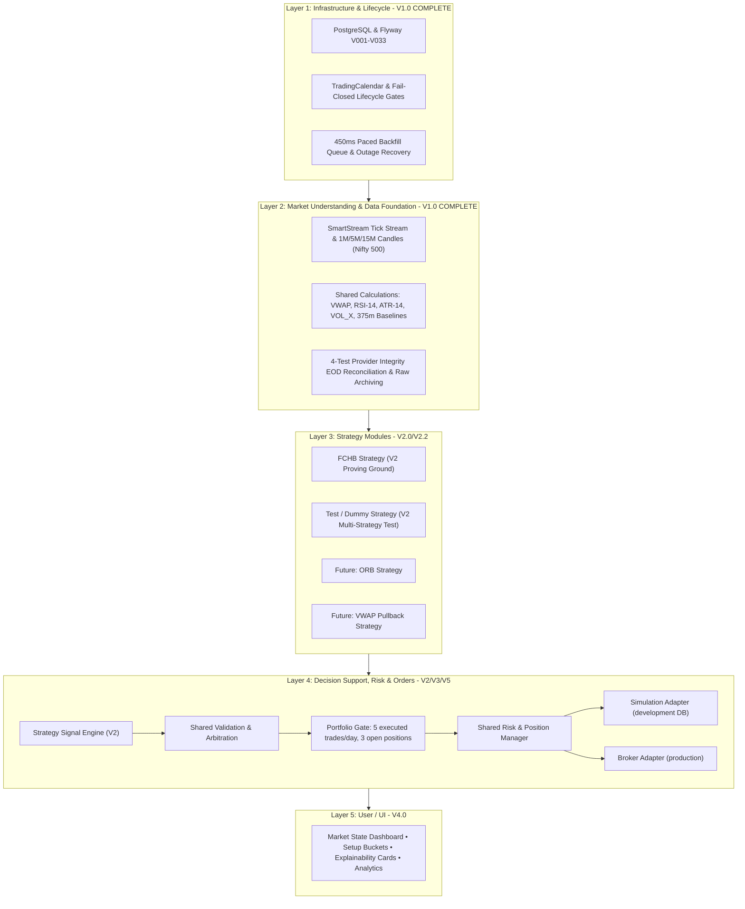
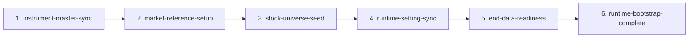
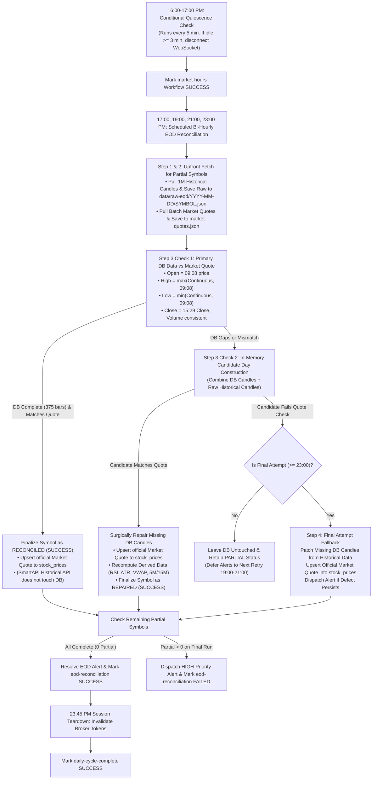

# Market Scanner Architecture & Workflow Guide (`project_workflow.md`)

This document is the authoritative developer, tester, and architecture guide for Mithron. It tracks the complete, chronological end-to-end application lifecycle from data foundation to strategy evaluation, risk-integrated historical backtesting, interactive trader UI, real-time order execution, and small-capital live trading.

---

### Master Version Scope Boundaries

- **Version 1.0 (Data & Market Lifecycle Foundation - COMPLETE ✅):**
  - **Phase 1:** Application Bootstrapping & Startup Readiness (6 fail-closed stages).
  - **Phase 2:** Daily Pre-Market Pipeline (07:00 AM Maintenance, 08:00 AM Data Preparation, 08:50 AM EOD Catchup Cutoff, 08:55 AM Live Start Gate).
  - **Phase 3:** Live Market Ingestion & Intraday Gap Repair (08:55 AM to Post-Market Quiescence, 450ms Paced Queue Worker across Nifty 500).
  - **Phase 4:** Shared Calculation & Common Indicator Engine (VWAP, Wilder's RSI-14, ATR-14, VOL_X, Baselines, Candle Structure).
  - **Phase 5:** Post-Market Feed Shutdown, Raw Broker Disk Archiving, 4-Test Provider Integrity EOD Reconciliation, Alerting & Session Teardown.
  - **Runtime Developer Tools:** Swagger OpenAPI Inspector, Authenticated SmartAPI Proxy (`/broker/smartapi/proxy`), On-Demand EOD Reconciliation.
  - **Verified State:** 321 unit tests passing (100%), 500-stock daily accumulation running live.

- **Version 2.0 (Strategy Intelligence & First Strategy Vertical Slice - NEXT MILESTONE):**
  - **V2.0: Architecture & Domain Contracts:** Canonical `MarketContext` (Master Market Filter: Binary Nifty VWAP evaluated on 5M candle closes; recoverable mid-session crosses; macro regimes deferred), `Strategy`, `StrategyEvaluation`, `StrategyProposal`, `StrategySignal`, parameter versioning, and deprecation/removal of legacy prototype code.
  - **V2.1: Evaluation Infrastructure & In-Memory Cache:** 5-minute candle close evaluation cadence (09:30–01:00 PM), in-memory `StockContextCache` across Nifty 500 (eliminating DB I/O bottleneck), fail-closed checks on active gap repair/backfill.
  - **V2.2: FCHB Strategy Module:** First 5-minute candle (09:15–09:19 AM) reference building, Rs. 1 Crore (`1,00,00,000`) turnover floor (`volume × typicalPrice`), 5M signal detection (`BO_% <= 0.8%`, `signalCandleVolume > 2.0 × firstCandleVolume` share count comparison, `VOL_X >= 1.8`, 5M RSI 55–72, VWAP alignment, GAP_UP suspension).
  - **V2.3: Validation, Priority Arbitration & Trade Gate:** StrategyValidator fail-closed gates, Global Strategy Priority Order (`Priority 1: ORB, Priority 2: FCHB, Priority 3: VWAP Pullback`), strictly **one entry per stock per day** (unfilled limit orders do not lock the stock; no re-entries after stop/target hit), global account caps (max 5 executed trades/day, max 3 concurrent open positions).
  - **V2.4: Signal Lifecycle & Audit Repository:** State transitions (`DETECTED` $\to$ `APPROVED` $\to$ `ACCEPTED` $\to$ `ACTIVE` $\to$ `INVALIDATED`/`EXPIRED`), immutable parameter snapshots, blocked signal retention (`SYMBOL_ALREADY_TRADED_TODAY`).
  - **V2.5: Hardening & Multi-Strategy Readiness:** Run FCHB through live simulation/paper trading; register a secondary dummy strategy to verify zero coupling and simultaneous execution.

- **Version 3.0 (Advanced Risk & Research Laboratory):**
  - Extend V2 baseline risk/position management with advanced portfolio controls and risk policies.
  - Expand point-in-time simulation analytics (win/loss, profit factor, drawdown, MFE/MAE, expectancy).
  - Improve failure analysis and compare versioned strategy behavior over larger historical samples.

- **Version 4.0 (Professional Web UI & Trader Dashboard):**
  - Live Market State & Nifty 500 Universe Overview.
  - Strategy Setup Buckets & Live Signal Cards with "Why is this stock here?" explainability.
  - Interactive Backtest Explorer & Strategy Analytics Charts.
  - Trade Plan Visualizer (Entry Zone, Stop, Target, Risk %).
  - Stock Search & History Timeline.

- **Version 5.0 (Trading Engine & Order Execution - SmartAPI):**
  - SmartAPI Order Service: `placeOrder`, `modifyOrder`, `cancelOrder`.
  - Live synchronization: Order Book, Trade Book, and Position Book.
  - Live execution integration with Risk Engine (Hard Daily Loss cutoff, Max Exposure, Kill Switch).
  - Order Lifecycle Audit Trail (`PROPOSED` $\to$ `SUBMITTED` $\to$ `FILLED` $\to$ `CLOSED`).

- **Version 6.0 (Small-Capital Live Trading & Paper/Live Toggle):**
  - Paper Mode vs Live Mode toggle.
  - Live execution with small real capital on proven strategies.
  - Production vs Backtest validation.

### Status Legend
- `[IMPLEMENTED + TESTED]`: Complete, verified in code, database, and test suite (321 unit tests passing).
- `[PLANNED]`: Architectural design finalized, scheduled for upcoming version release.

---

## Strategy Lifecycle and Promotion Pipeline

Each versioned strategy advances through explicit operating stages:

```text
Historical simulation on copied production data (development database)
        -> evidence review and rule/version decision
Live-market paper trading (no real orders)
        -> operational and behavior verification
Production trading (real broker orders)
```

The strategy and risk rules are shared across stages; only the database and execution adapter differ. Review focuses on incorrect trades, failure causes, data quality, and whether rule changes address those causes. Profitability is not the sole promotion criterion. Changes are post-market only, versioned, and do not rewrite prior evidence.

---

## 5-Layer System Architecture



---

## Phase 1: Application Bootstrapping & Startup Readiness `[IMPLEMENTED + TESTED]`

**Purpose:** Orchestrated by `RuntimeBootstrapService`, executes a fail-closed 6-stage sequence upon initial application launch. Startup records in `workflow_status` have `process_date = NULL`.



### Stage Details
1. **`instrument-master-sync`:** Downloads Angel One instrument catalog, populates `instrument_master`, verifies `NIFTY/NSE` exists.
2. **`market-reference-setup`:** Ensures `NIFTY/NSE` is configured as an active `INDEX` in `instrument_master`.
3. **`stock-universe-seed`:** Reads selected symbols from CSV, resolves each against `instrument_master` as the single source of truth, and seeds `stock_universe` (`is_active = true`, `is_tradable = false`).
4. **`runtime-setting-sync`:** Verifies and auto-heals 16 required configuration parameters in `runtime_setting`.
5. **`eod-data-readiness`:** Verifies verified EOD data exists for the **previous official trading day**. On fresh databases, seeds initial baseline `EodDataEntry` records.
6. **`runtime-bootstrap-complete`:** Performs a read-only token readiness check verifying non-blank broker tokens exist for all active stocks and `NIFTY`.

---

## Phase 2: Daily Pre-Market Pipeline `[IMPLEMENTED + TESTED]`

**Purpose:** Automated morning pipeline tracked in `workflow_status` (`workflow_group = "pre-market"`, `process_date = YYYY-MM-DD`). Orchestrated by `PreMarketWorkflowService`.

### Stage Details
1. **07:00 AM Morning Maintenance:**
   - **`trading-day-init`:** Queries `TradingCalendar` (`holiday_calendar` DB is single source of truth). If holiday/weekend, stops cleanly. If trading day, sets `runtime.process.date = today` and marks `SUCCESS`.
   - **`premarket-housekeeping`:** Purges data older than retention settings and clears memory caches.
2. **08:00 AM Pre-Market Data Preparation:**
   - **`premarket-catalog-sync`:** Downloads master catalog (143k scrips), maps 2,747 NSE Cash instruments & NIFTY (`99926000`), authenticates broker session early, and verifies broker tokens directly from DB.
   - **`premarket-universe-sync` (current behavior):** Reconciles active universe. Checks `eod_data_entry` for the previous trading day; if missing/incomplete for any symbol, demotes `is_tradable = false` while keeping `is_active = true`.
   - **Planned tradability rule:** Keep new symbols false by default. Set `is_tradable = true` only when EOD is complete and `stock_prices` contains at least the previous 20 official trading days; if the previous trading day EOD is incomplete, set false. This flag represents current data-integrity/export eligibility.
   - **`premarket-morning-reference`:** Authoritative computation of CPR, ADR, 15-day resistance, 20-day ADV, and 375m volume baseline curves for previous trading day into `DailyStockContext`.
3. **08:55 AM Live Start Gate & 09:10 AM Pre-Market Uncrossed Price Lock:**
   - **`premarket-live-start`:** Strictly verifies all 5 prior daily steps are `SUCCESS` for today's date before connecting the WebSocket and starting the `market-hours` stage.
   - **09:08-09:10 AM Pre-Market Price Locking:** Order uncrossing concludes by 09:08:00 AM (price frozen 09:08:00 to 09:14:59). The last tick price received for the 09:08 candle defines the uncrossed equilibrium price. By 09:10 AM, the `09:08:00` pre-market candle in `market_candles` is locked with $\text{Open} = \text{High} = \text{Low} = \text{Close} = \text{uncrossed price}$. All downstream gap analysis and daily context tables consume this canonical Day Open price.

---

## Phase 3: Live Market Ingestion & Intraday Gap Repair `[IMPLEMENTED + TESTED]`

**Purpose:** Connects to Angel One SmartStream WebSocket, ingests real-time binary ticks, constructs canonical 1-minute candles, tracks feed health, and triggers live gap repair.

### Workflow & Ingestion Rules
1. **08:55 AM - Pre-Open Feed Connect:** Connects WebSocket and subscribes to active universe equities and `NIFTY`. Ignores pre-09:08 order collection ticks to prevent stale data pollution.
2. **09:15 AM - Market Open Event:** Continuous session begins. VWAP resets strictly to 0. Day Type latched at 09:15 (`GAP_UP` > +0.75%, `GAP_DOWN` < -0.75%, `NORMAL`) using the 09:08 uncrossed Day Open.
3. **Continuous Binary Tick Processing:** `AngelOneTickParserService` decodes high-throughput packets; deduplicates duplicate ticks.
4. **1-Minute Candle Construction & DB Persistence:** `LiveMarketCandleService` accumulates ticks into 1M bars ($xx:xx:00 \dots xx:xx:59$), persists to `market_candles`, and updates `market_minute_snapshot`. Active symbols roll over immediately on the first tick of minute $T+1$; a background scheduled sweep at `:10` seconds past the minute finalizes any quiet/illiquid symbols directly from in-memory accumulators.
5. **Real-Time Gap Detection & Continuous Queue Worker Backfill:** Missing minute detected $\rightarrow$ enqueues job into `BackfillQueueService`. The background daemon worker continuously drains jobs at a paced rate of **450ms**, retrying temporary broker API limits, and confirming un-traded minutes as `NO_TRADE_CONFIRMED` upon retry exhaustion to release provisional ranges and unblock symbols cleanly.
6. **15:30 Market Close Policy:** Ingestion continues until post-16:00 to capture post-market settlement ticks.

---

## Phase 4: Shared Calculation & Common Indicator Engine `[IMPLEMENTED + TESTED]`

**Purpose:** Shared facts are calculated once and stored on canonical candle models to prevent calculation drift.

### Validation Standards:
1. **RSI-14 (Wilder's Smoothing):** Requires $\ge 42$ consecutive clean 1M candles of today. Stored on 1M, 5M, 15M. Within 0.1 points vs TradingView.
2. **ATR-14 (Wilder's Smoothing):** Requires $\ge 14$ consecutive clean 1M candles of today + authoritative `prevDayClose`. Within Rs. 0.05 vs TradingView.
3. **VWAP & Derived Metrics:** Cumulative $(\text{TP} \times \text{volume}) / \sum(\text{volume})$. Resets strictly at 09:15 AM. Evaluates `niftyAboveVwap`, `niftyVwapDirection`, and `vwapProximityPct`.
4. **Volume Baselines & Runtime VOL_X:** 20-day ADV and 375 session-minute baseline curves. Requires $\ge 20$ completed trading days.
5. **Candle Structure & Quality Flags:** Zero-range guard, body ratio, upper/lower wick ratios, range percentage, and strong bullish/bearish classification.

---

## Phase 5: Post-Market Shutdown, Archiving, EOD Reconciliation & Teardown `[IMPLEMENTED + TESTED]`

**Purpose:** Quiescence shutdown, upfront raw historical REST archiving, DB-first authoritative comparison against Market Quote, surgical in-memory candidate repair, 375-minute candle reconciliation, alert management, and daily session teardown.



---

## Strategy & Decision Roadmap Ahead: Version 2.0 to Version 6+ `[PLANNED]`

### Complete Version 2 Implementation Plan: Strategy Intelligence & First Strategy Vertical Slice (FCHB)

V2 delivers one strategy (**FCHB - First Candle High Breakout**) through historical simulation and live-market paper trading. It establishes Mithron's **canonical decision language**, proving the complete pipeline from market context to signals, validation, arbitration, trade gating, and audit logging before any real-money order execution is enabled.

---

#### 1. Architectural Core & Guiding Principles

- **Vertical Slice Delivery:** Deliver FCHB end-to-end to validate the entire decision language and pipeline (Context $\to$ Strategy $\to$ Validator $\to$ Arbitration $\to$ Audit Trail) rather than building half-finished pieces of multiple strategies.
- **Separation of Concerns:** Strategies are pure decision functions (`pure functions`). They **never** fetch database records, invoke broker APIs, or calculate shared indicators. They consume finalized context and emit immutable proposals.
- **Fail-Closed Safety:** If data is missing, if a backfill job is active for the symbol, if market hours are violated, or if indicators are unready, evaluation immediately fails closed (`NOT_EVALUABLE` / `REJECTED`).

---

#### 2. V2.0 — Architecture Decisions, Domain Contracts & Legacy Retirement

- **Canonical Domain Models:**
  - `MarketContext`: Root context encapsulating macro `MarketState` (NIFTY regime) and micro `StockContext` (500 equities).
  - `MarketState`: Captures master market filter state (`ACTIVE` vs `SUSPENDED`) based on NIFTY 5M VWAP status.
  - `StockContext`: In-memory container providing pre-market baselines, opening reference candle, sliding windows of 1M, 5M, and 15M candles, current prices, and pre-calculated indicators.
  - `Strategy`: Pure interface `evaluate(StockContext, MarketState, StrategyParameters) -> StrategyEvaluation`.
  - `StrategyEvaluation`: Evaluation outcome (`QUALIFIED`, `NOT_QUALIFIED`, `NOT_EVALUABLE`), proposal details, confidence score, and explicit `passedConditions` and `failedConditions` lists.
  - `StrategyProposal`: Symbol, strategyId, direction (`LONG`), entry price, initial stop loss, target 1, target 2, structural invalidation level, and confidence score.
  - `StrategyValidator`: Fail-closed gatekeeper interface checking data readiness, trading windows, and structural limits.
  - `ValidationResult`: Gatekeeper output (`APPROVED` vs `REJECTED`) with specific failure code.
  - `TradeCandidate`: Deduplicated and validated signal candidate ready for portfolio arbitration.
  - `TradeIntent`: Portfolio-level accepted trade candidate with sizing, protective stop plan, and execution parameters.
  - `SignalAudit`: Immutable persisted record containing timestamp, symbol, strategy ID, parameter snapshot (JSON), evaluated conditions, and disposition.
- **Legacy Prototype Retirement:**
  - Safely deprecate and delete obsolete prototype classes: `LiveSignalService`, `LiveSimulationSignal`, `BreakoutSignalEvaluator`, `BreakoutSignalGenerator`, `StrategyScoringService`, `StrategyCatalogService`, `StrategyYamlDefinition`, `ScoreDecision`.
  - Delete legacy YAML strategy definitions in `src/main/resources/strategies/`.
  - Maintain 100% test pass rate across all existing unit and integration tests.

---

#### 3. V2.1 — Master Market Filter & Evaluation Infrastructure

- **Master Market Filter (NIFTY 5M VWAP Switch):**
  - **Rule:** Nifty 5M Close > Nifty VWAP $\to$ Long rules **ACTIVE**. Nifty 5M Close < Nifty VWAP $\to$ Long rules **SUSPENDED**.
  - **Evaluation Cadence:** Evaluated strictly on **5M candle closes** (09:30 AM onwards). 1M and tick-level crosses are noise and ignored.
  - **Mid-Session Cross Recovery:** If Nifty 5M close drops below VWAP, new entries are suspended immediately from that candle close. If a subsequent 5M candle closes back above VWAP prior to 01:00 PM, new entries are re-enabled. Day is **not** permanently killed.
  - **Re-enable Exceptions:** Do not re-enable if time is past 01:00 PM, daily loss kill switch has fired, or session is in wind-down ($\ge$ 02:45 PM).
  - **Macro Regimes Deferred:** The four macro regimes (`TRENDING_UP`, `TRENDING_DOWN`, `RANGE`, `BREAKOUT_ENV`) are deferred until post-simulation empirical data justifies added complexity.
- **Evaluation Cadence & In-Memory Performance:**
  - **Cadence:** Evaluated every 5 minutes on 5M candle close (09:30 AM to 01:00 PM) rather than polling every 60 seconds.
  - **In-Memory Cache:** `StockContextCache` maintains an in-memory sliding window for 500 stocks, eliminating database I/O bottlenecks.
  - **Fail-Closed Gap/Repair Guard:** Rejects evaluation immediately if `backfillQueueService.hasActiveOrPendingJobs(symbol, today)`.

---

#### 4. V2.2 — First Candle High Breakout (FCHB) Strategy Slice

- **First Candle Reference Building (09:15 to 09:19 AM):**
  - Built from five 1M candles: 09:15, 09:16, 09:17, 09:18, 09:19.
  - `firstCandleOpen = open of 09:15 candle`
  - `firstCandleHigh = max(high) across all 5 candles`
  - `firstCandleLow = min(low) across all 5 candles`
  - `firstCandleClose = close of 09:19 candle`
  - `firstCandleVolume = sum(volume) across all 5 candles`
  - `firstCandleTypicalPrice = (firstCandleHigh + firstCandleLow + firstCandleClose) / 3`
  - `firstCandleTurnover = firstCandleVolume * firstCandleTypicalPrice`
  - `firstCandleRangePct = (firstCandleHigh - firstCandleLow) / firstCandleLow * 100`
  - `firstCandleBullish = firstCandleClose > firstCandleOpen` (strictly green)
- **First Candle Quality Gate (if any condition fails $\to$ FCHB suspended for symbol today):**
  - `firstCandleRangePct >= 0.15%` and `<= 3.0%`
  - `firstCandleTurnover >= 1,00,00,000` (**Minimum Rs. 1 Crore floor**)
  - `firstCandleBullish == true` (strictly bullish opening candle)
  - All 5 1M candles present and finalized
- **Signal Detection Rules (5M candle close, 09:30 AM to 01:00 PM):**
  1. 5M candle closes ABOVE `firstCandleHigh`
  2. Breakout extension: `BO_% = (5M_Close - firstCandleHigh) / firstCandleHigh * 100 <= 0.8%`
  3. Signal candle volume: `signalCandleVolume > 2.0 * firstCandleVolume` (direct 5M share-to-share comparison)
  4. Time-normalized volume: `VOL_X >= 1.8`
  5. Momentum: 5M RSI between 55 and 72
  6. VWAP support: Stock Close > Stock VWAP
  7. Dual timeframe trend: 15M Close > 15M VWAP
  8. Strong bullish candle: `bodyRatio >= 0.60`, `upperWickRatio <= 0.25`, `rangePct >= 0.15%`
  9. Master Market Filter: Nifty 5M Close > Nifty VWAP
  10. Time Window: Signal time between 09:30 AM and 01:00 PM
  11. Confidence Score: Score $\ge 60$ (calculated across BO_%, VOL_X, RSI, Nifty margin, and dual timeframe alignment)
- **Entry Order Protocol:**
  - On signal confirmation, wait for next 1M confirmation candle to close green above `firstCandleHigh`
  - Place Limit Buy order at `confirmationCandleHigh + 0.1%`
  - Auto-cancel limit order after 2 minutes if unfilled (prevents late fills on adverse moves)
- **Invalidation, Stop Loss & Targets:**
  - Initial Stop Loss: `firstCandleLow * 0.995` (placed as GTT on fill)
  - Early Structural Exit: If any 1M candle closes back inside the first candle range (close < `firstCandleHigh`), exit at market immediately.
  - Target 1: `entryPrice + 1R` (market exit of 50% position; $1R = \text{entryPrice} - \text{stopLossPrice}$)
  - Breakeven Stop: When price reaches 0.8R, move stop loss up to `entryPrice` (0R)
  - Target 2: ATR-based trailing stop on remaining 50% position (`1M_low - 0.5 * 5M_ATR`, only moves up)
- **Hard Filters & Day Type Suspensions:**
  - Gap-Up Day: If Nifty opens $> +0.75\%$, FCHB is suspended for the entire day.
  - Individual Stock Gap: If stock opens $> +1.5\%$, FCHB is suspended for this stock today.
  - Extended Move: Skip if `(currentPrice - todayOpenPrice) / todayOpenPrice > 2.5%`.
  - Circuit Proximity: Skip if `currentPrice > upperCircuitLimit * 0.98`.
  - Post-Volatile Day: Skip if `prevDayRangePct > 4.0%`.
  - Multi-Week Resistance: Skip if `(highestClose15d - prevDayClose) / prevDayClose * 100 < 1.0%`.
  - Expiry Rules: On Weekly Expiry, `VOL_X` threshold raised to 2.5, min score raised to 75, max trades reduced to 3, hard close at 02:15 PM. On Monthly Expiry, all strategies suspended.

---

#### 5. V2.3 — Strategy Validator, Arbitration & Portfolio Trade Gate

- **Multi-Strategy Priority Order:**
  - **Priority 1:** ORB (Opening Range Breakout)
  - **Priority 2:** FCHB (First Candle High Breakout)
  - **Priority 3:** VWAP Pullback
  - Winning strategy owns the symbol through position exit; losing signal recorded as `SYMBOL_ALREADY_TRADED_TODAY`.
- **Trade Gate & Lifecycle Guardrails:**
  - Strictly **one entry per stock per day** across all strategies combined (win or lose).
  - **Phantom Signal Protection:** Unfilled or auto-cancelled limit orders do **NOT** count as entries (no premature symbol lock).
  - Global Limits: Maximum 5 executed trades per day and 3 simultaneously open positions account-wide.
  - Risk Engine Checks:
    1. Open positions < 3
    2. Total current risk < 3.2% of capital (using current trailing stop levels)
    3. Daily loss < 4% of capital (cumulative realized + unrealized)
    4. Total trades today < 5 (trades 4-5 require confidence score $\ge 80$)
    5. R:R after charges $\ge 1.5$ (estimated round-trip charges Rs. 60)

---

#### 6. V2.4 — Signal Lifecycle, Audit Repository & Parameter Management

- **Audit Persistence:**
  - Persist all evaluations to `strategy_signals` table (qualified, rejected, not evaluable).
  - Store evaluated conditions as structured JSON (`passed_conditions`, `failed_conditions`).
  - Capture immutable `parameter_snapshot` JSON with every evaluation.
- **Parameter Management:**
  - YAML bootstrap seeds initial defaults to `strategy_parameter` table on startup without overwriting runtime DB overrides on restart.
  - Versioned parameters (`strategy_version`, `rule_version`).

---

#### 7. V2.5 — Hardening, Test Suite & Multi-Strategy Readiness

- Register a secondary dummy/mock strategy alongside FCHB to verify deterministic arbitration and zero-coupling.
- Comprehensive unit and integration test coverage for FCHB calculations, boundary cases, turnover floors, and fail-closed gates.
- Verify 100% pass rate across all existing 321 tests.

### Version 3.0: Advanced Risk & Research Laboratory
- Extend the V2 baseline risk and position manager with advanced portfolio controls and risk policies.
- Expand point-in-time simulation analytics: win/loss rate, profit factor, max drawdown, MFE/MAE, and expectancy.
- Improve failure analysis and compare strategy versions over larger historical samples.

### Version 4.0: Professional Web UI & Trader Dashboard
- Live market state and Nifty 500 universe overview.
- Strategy setup buckets with "Why is this stock here?" explainability.
- Interactive backtest explorer, analytics charts, and trade plan visualizer.

### Version 5.0: Production Execution Adapter (SmartAPI)
- SmartAPI order integration (`placeOrder`, `modifyOrder`, `cancelOrder`).
- Regular order, trade, and open-position detail reconciliation.
- Integrate the shared portfolio limits and risk/position manager; paper and real-money records use separate tables. Broker-accepted protective orders remain active during application-side data-recovery pauses.

### Version 6.0: Controlled Real-Money Stage
- Promote only a version that has completed historical simulation and live-market paper trading review.
- Start with small real capital and compare observed production behavior with simulation and paper evidence.

---

## Runtime Admin & Developer Endpoints `[IMPLEMENTED + TESTED]`

| Endpoint | Method | Purpose |
|---|---|---|
| `/admin/runtime/broker/smartapi/proxy` | `POST` | Authenticated SmartAPI proxy inspector to call any broker endpoint with active session headers |
| `/admin/runtime/broker/warmup` | `POST` | Warm up or refresh broker session tokens |
| `/admin/runtime/broker/status` | `GET` | Inspect active session token validity and expiration state |
| `/admin/runtime/broker/clear` | `POST` | Clear cached session tokens |
| `/admin/runtime/broker/reconcile-startup` | `POST` | Manually run startup state reconciliation |
| `/admin/runtime/connect-and-subscribe` | `POST` | Manually connect WebSocket and subscribe active universe |
| `/admin/runtime/flush-and-disconnect` | `POST` | Manually flush live candles and disconnect WebSocket |
| `/admin/runtime/eod/reconcile` | `POST` | Trigger on-demand 375-minute EOD reconciliation for any trading date |
| `/admin/runtime/housekeeping/run` | `POST` | Run historical data housekeeping purge on demand |
| `/admin/runtime/alerts` | `GET` | List all runtime alerts and their current resolution status |

---

## Core Database Tables Map

| Table Name | Primary Role | Key Columns |
|---|---|---|
| `workflow_status` | Workflow tracking & fail-closed dependency gates | `name`, `workflow_group`, `process_date`, `status`, `depends_on_workflow_id`, `is_active` |
| `instrument_master` | Canonical broker instrument catalog | `symbol`, `token`, `instrument_type`, `segment`, `is_active` |
| `stock_universe` | Curated universe and current data-integrity/export eligibility | `symbol`, `is_active`, `is_tradable`, `active_from`, `source` |
| `runtime_setting` | Dynamic operational parameters & crons | `name`, `value`, `value_type`, `is_active`, `updated_at` |
| `holiday_calendar` | Official exchange trading calendar | `holiday_date`, `description`, `is_trading_day` |
| `eod_data_entry` | EOD data completeness tracking | `symbol`, `trading_date`, `status`, `minute_count`, `matched_candles`, `repaired_candles` |
| `stock_prices` | Authoritative daily OHLCV prices | `symbol`, `trade_date`, `open`, `high`, `low`, `close`, `volume`, `vwap` |
| `market_candles` | 1M, 5M, 15M candles & indicators | `symbol`, `timeframe`, `candle_time`, `vwap`, `rsi_14`, `atr_14`, `quality_status` |
| `volume_daily_baseline` | Rolling 20-day ADV baselines | `symbol`, `avg_daily_volume_20`, `as_of_date` |
| `volume_time_window_baseline` | 375 session-minute baseline curves | `symbol`, `session_minute`, `cumulative_volume_mean` |
| `live_feed_state` | WebSocket connection & feed health | `connection_state`, `last_tick_time`, `subscribed_count` |
| `runtime_alert_state` | Runtime alerting audit log & status | `alert_key`, `severity`, `status`, `message`, `details` |
| `strategy_config` `[V2]` | Registered strategy definitions & priorities | `strategy_id`, `strategy_version`, `is_enabled`, `priority`, `description` |
| `strategy_parameter` `[V2]` | Dynamic versioned strategy parameters | `strategy_id`, `parameter_name`, `parameter_value`, `parameter_version`, `effective_from` |
| `strategy_signals` `[V2]` | Immutable signal evaluations & audit store | `signal_id`, `symbol`, `strategy_id`, `signal_status`, `passed_conditions`, `parameter_snapshot` |
| `trade_intents` `[V2]` | Shared trade gate accepted actionable candidates | `intent_id`, `signal_id`, `symbol`, `direction`, `entry_price`, `invalidation_price`, `status` |
| `positions` / `orders` `[PLANNED]` | Position lifecycle, changing trade plan, broker reconciliation, and simulated/real execution audit | position/order IDs, owning strategy version, quantities, stop/target plan, broker state, lifecycle status |
| `simulation_runs` `[PLANNED]` | Reproducible historical simulation scope and assumptions | date range, copied-universe snapshot, strategy/rule versions, execution assumptions |

---

## Execution Status Summary

- [x] **Phase 1: Startup Pipeline Verification** `[COMPLETED + TESTED]`
- [x] **Phase 2: Daily Pre-Market Workflow Verification** `[COMPLETED + TESTED]`
- [x] **Phase 3: Live Market Ingestion & Feed Health Deep-Dive** `[COMPLETED + TESTED]`
- [x] **Phase 4: Shared Calculation & Common Engine Audit** `[COMPLETED + TESTED]`
- [x] **Phase 5: Post-Market Shutdown, Archiving, EOD Reconciliation & Teardown** `[COMPLETED + TESTED]`
- [ ] **V2.0: Architecture & Domain Contracts** `[PLANNED]`
- [ ] **V2.1: Market State & Evaluation Infrastructure** `[PLANNED]`
- [ ] **V2.2: FCHB Strategy Module** `[PLANNED]`
- [ ] **V2.3: Strategy Validator & Trade Guard** `[PLANNED]`
- [ ] **V2.4: Signal Lifecycle & Audit Repository** `[PLANNED]`
- [ ] **V2.5: Hardening & Multi-Strategy Readiness** `[PLANNED]`
- [ ] **V3.0: Advanced Risk & Research Laboratory** `[PLANNED]`
- [ ] **V4.0: Professional Web UI & Trader Dashboard** `[PLANNED]`
- [ ] **V5.0: Trading Engine & Order Execution (SmartAPI)** `[PLANNED]`
- [ ] **V6.0: Small-Capital Live Trading & Paper/Live Toggle** `[PLANNED]`
