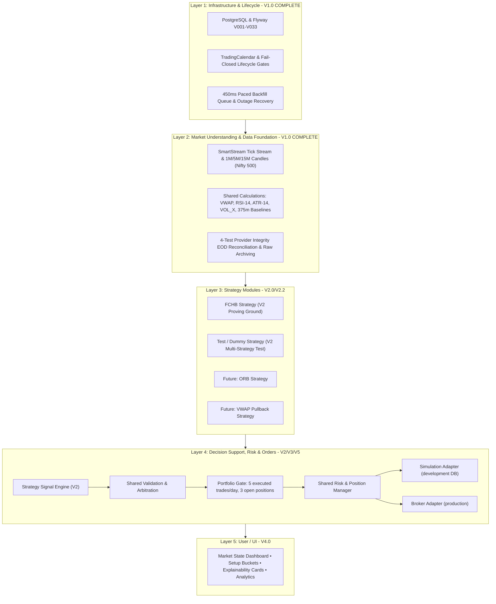
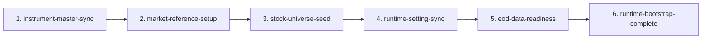
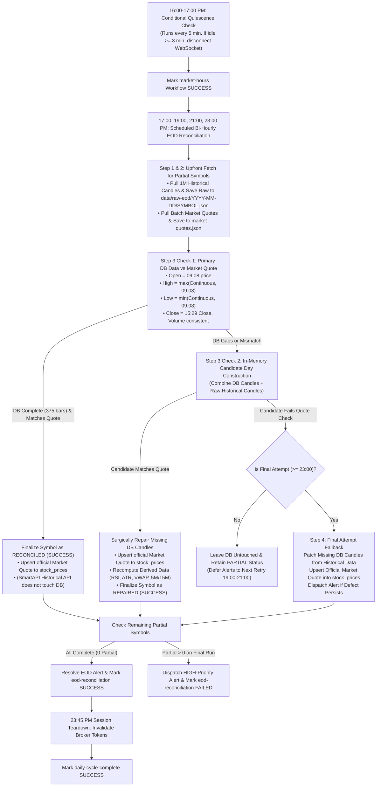

# Market Scanner Architecture & Workflow Guide (`project_workflow.md`)

This document is the authoritative developer, tester, and architecture guide for Mithron. It tracks the complete, chronological end-to-end application lifecycle from data foundation to strategy evaluation, risk-integrated historical backtesting, interactive trader UI, real-time order execution, and small-capital live trading.

---

### Master Version Scope Boundaries

- **Version 1.0 (Data & Market Lifecycle Foundation - COMPLETE ✅):**
  - **Phase 1:** Application Bootstrapping & Startup Readiness (6 fail-closed stages).
  - **Phase 2:** Daily Pre-Market Pipeline (07:00 AM Maintenance, 08:00 AM Data Preparation, 08:50 AM EOD Catchup Cutoff, 08:55 AM Live Start Gate).
  - **Phase 3:** Live Market Ingestion & Intraday Gap Repair (08:55 AM to Post-Market Quiescence, 450ms Paced Queue Worker across Nifty 500).
  - **Phase 4:** Shared Calculation & Common Indicator Engine (VWAP, Wilder's RSI-14, ATR-14, VOL_X, Baselines, Candle Structure).
  - **Phase 5:** Post-Market Feed Shutdown, Raw Broker Disk Archiving, 4-Test Provider Integrity EOD Reconciliation, Alerting & Session Teardown.
  - **Runtime Developer Tools:** Swagger OpenAPI Inspector, Authenticated SmartAPI Proxy (`/broker/smartapi/proxy`), On-Demand EOD Reconciliation.
  - **Verified State:** 321 unit tests passing (100%), 500-stock daily accumulation running live.

- **Version 2.0 (Strategy Intelligence & First Strategy Vertical Slice - NEXT MILESTONE):**
  - **V2.0: Architecture & Domain Contracts:** Canonical `MarketContext` (Master Market Filter: Binary Nifty VWAP evaluated on 5M candle closes; recoverable mid-session crosses; macro regimes deferred), `Strategy`, `StrategyEvaluation`, `StrategyProposal`, `StrategySignal`, parameter versioning, and deprecation/removal of legacy prototype code.
  - **V2.1: Evaluation Infrastructure & In-Memory Cache:** 5-minute candle close evaluation cadence (09:30–01:00 PM), in-memory `StockContextCache` across Nifty 500 (eliminating DB I/O bottleneck), fail-closed checks on active gap repair/backfill.
  - **V2.2: FCHB Strategy Module:** First 5-minute candle (09:15–09:19 AM) reference building, Rs. 1 Crore (`1,00,00,000`) turnover floor (`volume × typicalPrice`), 5M signal detection (`BO_% <= 0.8%`, `signalCandleVolume > 2.0 × firstCandleVolume` share count comparison, `VOL_X >= 1.8`, 5M RSI 55–72, VWAP alignment, GAP_UP suspension).
  - **V2.3: Validation, Priority Arbitration & Trade Gate:** StrategyValidator fail-closed gates, Global Strategy Priority Order (`Priority 1: ORB, Priority 2: FCHB, Priority 3: VWAP Pullback`), strictly **one entry per stock per day** (unfilled limit orders do not lock the stock; no re-entries after stop/target hit), global account caps (max 5 executed trades/day, max 3 concurrent open positions).
  - **V2.4: Signal Lifecycle & Audit Repository:** State transitions (`DETECTED` $\to$ `APPROVED` $\to$ `ACCEPTED` $\to$ `ACTIVE` $\to$ `INVALIDATED`/`EXPIRED`), immutable parameter snapshots, blocked signal retention (`SYMBOL_ALREADY_TRADED_TODAY`).
  - **V2.5: Hardening & Multi-Strategy Readiness:** Run FCHB through live simulation/paper trading; register a secondary dummy strategy to verify zero coupling and simultaneous execution.

- **Version 3.0 (Advanced Risk & Research Laboratory):**
  - Extend V2 baseline risk/position management with advanced portfolio controls and risk policies.
  - Expand point-in-time simulation analytics (win/loss, profit factor, drawdown, MFE/MAE, expectancy).
  - Improve failure analysis and compare versioned strategy behavior over larger historical samples.

- **Version 4.0 (Professional Web UI & Trader Dashboard):**
  - Live Market State & Nifty 500 Universe Overview.
  - Strategy Setup Buckets & Live Signal Cards with "Why is this stock here?" explainability.
  - Interactive Backtest Explorer & Strategy Analytics Charts.
  - Trade Plan Visualizer (Entry Zone, Stop, Target, Risk %).
  - Stock Search & History Timeline.

- **Version 5.0 (Trading Engine & Order Execution - SmartAPI):**
  - SmartAPI Order Service: `placeOrder`, `modifyOrder`, `cancelOrder`.
  - Live synchronization: Order Book, Trade Book, and Position Book.
  - Live execution integration with Risk Engine (Hard Daily Loss cutoff, Max Exposure, Kill Switch).
  - Order Lifecycle Audit Trail (`PROPOSED` $\to$ `SUBMITTED` $\to$ `FILLED` $\to$ `CLOSED`).

- **Version 6.0 (Small-Capital Live Trading & Paper/Live Toggle):**
  - Paper Mode vs Live Mode toggle.
  - Live execution with small real capital on proven strategies.
  - Production vs Backtest validation.

### Status Legend
- `[IMPLEMENTED + TESTED]`: Complete, verified in code, database, and test suite (321 unit tests passing).
- `[PLANNED]`: Architectural design finalized, scheduled for upcoming version release.

---

## Strategy Lifecycle and Promotion Pipeline

Each versioned strategy advances through three explicit operating stages:

```text
Stage 1: Historical simulation on copied production data (Local development database)
        -> Evaluates exact paper trading pipeline across historical candle sequences
        -> Evidence review, rule defect analysis, and version calibration
Stage 2: Live-market paper trading (Production or staging environment, no real orders)
        -> Real-time operational verification during live market hours (09:15-15:30)
Stage 3: Controlled production trading (Real broker orders via SmartAPI)
        -> Real capital deployed with small size on validated setups
```

### Shared Engine Architecture: Simulation as Fast-Forward Paper Trading
- **100% Identical Workflow & Code Paths:**
  - Historical simulation in the local development database runs the **exact same paper trading workflow** as live market hours.
  - Both stages share:
    1. The identical strategy decision pure functions (`Strategy.evaluate(StockContext, MarketState)`).
    2. The identical Traffic-Light Quality Gate (Red / Yellow / Green matrix).
    3. The identical position and trailing stop handlers (`StrategyPositionHandler.evaluatePosition(...)`).
    4. The identical risk gate and portfolio state machine (`RiskEngine` with `PortfolioState(PAPER)`).
    5. The identical simulated execution adapter (`SimulatedTradeExecutionAdapter`), writing to the identical tables (`simulated_signals`, `simulated_orders`, `simulated_positions`).
- **The Only Difference is the Event Driver / Clock:**
  - **Live Paper Trading:** Time is driven by the real-time system clock, live WebSocket binary ticks, and scheduled 1M/5M candle boundary events.
  - **Historical Simulation:** Time is driven by a fast-forward historical replay driver that feeds finalized historical candles bar-by-bar into the exact same orchestrator, simulating fills at the next candle open.
- **Why This Matters (Zero Code Drift):**
  - Eliminates the classic quantitative trap of maintaining a separate "backtester" codebase in Python or custom scripts that drifts from the live execution bot.
  - A strategy validated in historical simulation on dev DB is guaranteed to execute identically in live-market paper trading.
  - The developer can copy historical candle data from production into the local development database, run extensive simulations across 30+ session days, inspect the resulting `simulated_*` records and `rule_context` JSON audit snapshots, and iterate safely with zero risk to production data or real broker sessions.

---

## 5-Layer System Architecture



---

## Phase 1: Application Bootstrapping & Startup Readiness `[IMPLEMENTED + TESTED]`

**Purpose:** Orchestrated by `RuntimeBootstrapService`, executes a fail-closed 6-stage sequence upon initial application launch. Startup records in `workflow_status` have `process_date = NULL`.



### Stage Details
1. **`instrument-master-sync`:** Downloads Angel One instrument catalog, populates `instrument_master`, verifies `NIFTY/NSE` exists.
2. **`market-reference-setup`:** Ensures `NIFTY/NSE` is configured as an active `INDEX` in `instrument_master`.
3. **`stock-universe-seed`:** Reads selected symbols from CSV, resolves each against `instrument_master` as the single source of truth, and seeds `stock_universe` (`is_active = true`, `is_tradable = false`).
4. **`runtime-setting-sync`:** Verifies and auto-heals 16 required configuration parameters in `runtime_setting`.
5. **`eod-data-readiness`:** Verifies verified EOD data exists for the **previous official trading day**. On fresh databases, seeds initial baseline `EodDataEntry` records.
6. **`runtime-bootstrap-complete`:** Performs a read-only token readiness check verifying non-blank broker tokens exist for all active stocks and `NIFTY`.

---

## Phase 2: Daily Pre-Market Pipeline `[IMPLEMENTED + TESTED]`

**Purpose:** Automated morning pipeline tracked in `workflow_status` (`workflow_group = "pre-market"`, `process_date = YYYY-MM-DD`). Orchestrated by `PreMarketWorkflowService`.

### Stage Details
1. **07:00 AM Morning Maintenance:**
   - **`trading-day-init`:** Queries `TradingCalendar` (`holiday_calendar` DB is single source of truth). If holiday/weekend, stops cleanly. If trading day, sets `runtime.process.date = today` and marks `SUCCESS`.
   - **`premarket-housekeeping`:** Purges data older than retention settings and clears memory caches.
2. **08:00 AM Pre-Market Data Preparation:**
   - **`premarket-catalog-sync`:** Downloads master catalog (143k scrips), maps 2,747 NSE Cash instruments & NIFTY (`99926000`), authenticates broker session early, and verifies broker tokens directly from DB.
   - **`premarket-universe-sync` (current behavior):** Reconciles active universe. Checks `eod_data_entry` for the previous trading day; if missing/incomplete for any symbol, demotes `is_tradable = false` while keeping `is_active = true`.
   - **Planned tradability rule:** Keep new symbols false by default. Set `is_tradable = true` only when EOD is complete and `stock_prices` contains at least the previous 20 official trading days; if the previous trading day EOD is incomplete, set false. This flag represents current data-integrity/export eligibility.
   - **`premarket-morning-reference`:** Authoritative computation of CPR, ADR, 15-day resistance, 20-day ADV, and 375m volume baseline curves for previous trading day into `DailyStockContext`.
3. **08:55 AM Live Start Gate & 09:10 AM Pre-Market Uncrossed Price Lock:**
   - **`premarket-live-start`:** Strictly verifies all 5 prior daily steps are `SUCCESS` for today's date before connecting the WebSocket and starting the `market-hours` stage.
   - **09:08-09:10 AM Pre-Market Price Locking:** Order uncrossing concludes by 09:08:00 AM (price frozen 09:08:00 to 09:14:59). The last tick price received for the 09:08 candle defines the uncrossed equilibrium price. By 09:10 AM, the `09:08:00` pre-market candle in `market_candles` is locked with $\text{Open} = \text{High} = \text{Low} = \text{Close} = \text{uncrossed price}$. All downstream gap analysis and daily context tables consume this canonical Day Open price.

---

## Phase 3: Live Market Ingestion & Intraday Gap Repair `[IMPLEMENTED + TESTED]`

**Purpose:** Connects to Angel One SmartStream WebSocket, ingests real-time binary ticks, constructs canonical 1-minute candles, tracks feed health, and triggers live gap repair.

### Workflow & Ingestion Rules
1. **08:55 AM - Pre-Open Feed Connect:** Connects WebSocket and subscribes to active universe equities and `NIFTY`. Ignores pre-09:08 order collection ticks to prevent stale data pollution.
2. **09:15 AM - Market Open Event:** Continuous session begins. VWAP resets strictly to 0. Day Type latched at 09:15 (`GAP_UP` > +0.75%, `GAP_DOWN` < -0.75%, `NORMAL`) using the 09:08 uncrossed Day Open.
3. **Continuous Binary Tick Processing:** `AngelOneTickParserService` decodes high-throughput packets; deduplicates duplicate ticks.
4. **1-Minute Candle Construction & DB Persistence:** `LiveMarketCandleService` accumulates ticks into 1M bars ($xx:xx:00 \dots xx:xx:59$), persists to `market_candles`, and updates `market_minute_snapshot`. Active symbols roll over immediately on the first tick of minute $T+1$; a background scheduled sweep at `:10` seconds past the minute finalizes any quiet/illiquid symbols directly from in-memory accumulators.
5. **Real-Time Gap Detection & Continuous Queue Worker Backfill:** Missing minute detected $\rightarrow$ enqueues job into `BackfillQueueService`. The background daemon worker continuously drains jobs at a paced rate of **450ms**, retrying temporary broker API limits, and confirming un-traded minutes as `NO_TRADE_CONFIRMED` upon retry exhaustion to release provisional ranges and unblock symbols cleanly.
6. **15:30 Market Close Policy:** Ingestion continues until post-16:00 to capture post-market settlement ticks.

---

## Phase 4: Shared Calculation & Common Indicator Engine `[IMPLEMENTED + TESTED]`

**Purpose:** Shared facts are calculated once and stored on canonical candle models to prevent calculation drift.

### Validation Standards:
1. **RSI-14 (Wilder's Smoothing):** Requires $\ge 42$ consecutive clean 1M candles of today. Stored on 1M, 5M, 15M. Within 0.1 points vs TradingView.
2. **ATR-14 (Wilder's Smoothing):** Requires $\ge 14$ consecutive clean 1M candles of today + authoritative `prevDayClose`. Within Rs. 0.05 vs TradingView.
3. **VWAP & Derived Metrics:** Cumulative $(\text{TP} \times \text{volume}) / \sum(\text{volume})$. Resets strictly at 09:15 AM. Evaluates `niftyAboveVwap`, `niftyVwapDirection`, and `vwapProximityPct`.
4. **Volume Baselines & Runtime VOL_X:** 20-day ADV and 375 session-minute baseline curves. Requires $\ge 20$ completed trading days.
5. **Candle Structure & Quality Flags:** Zero-range guard, body ratio, upper/lower wick ratios, range percentage, and strong bullish/bearish classification.

---

## Phase 5: Post-Market Shutdown, Archiving, EOD Reconciliation & Teardown `[IMPLEMENTED + TESTED]`

**Purpose:** Quiescence shutdown, upfront raw historical REST archiving, DB-first authoritative comparison against Market Quote, surgical in-memory candidate repair, 375-minute candle reconciliation, alert management, and daily session teardown.



---

## Strategy & Decision Roadmap Ahead: Version 2.0 to Version 6+ `[PLANNED]`

### Complete Version 2 Implementation Plan: Strategy Intelligence & First Strategy Vertical Slice (FCHB)

V2 delivers one strategy (**FCHB - First Candle High Breakout**) through historical simulation and live-market paper trading. It establishes Mithron's **canonical decision language**, proving the complete pipeline from market context to signals, validation, arbitration, trade gating, and audit logging before any real-money order execution is enabled.

---

#### 1. Architectural Core & Guiding Principles

- **Vertical Slice Delivery:** Deliver FCHB end-to-end to validate the entire decision language and pipeline (Context $\to$ Strategy $\to$ Validator $\to$ Arbitration $\to$ Audit Trail) rather than building half-finished pieces of multiple strategies.
- **Separation of Concerns:** Strategies are pure decision functions (`pure functions`). They **never** fetch database records, invoke broker APIs, or calculate shared indicators. They consume finalized context and emit immutable proposals.
- **Fail-Closed Safety:** If data is missing, if a backfill job is active for the symbol, if market hours are violated, or if indicators are unready, evaluation immediately fails closed (`NOT_EVALUABLE` / `REJECTED`).

---

#### 2. V2.0 — Architecture Decisions, Domain Contracts & Legacy Retirement `[RETIREMENT COMPLETE ✅]`

- **Canonical Domain Models:**
  - `MarketContext`: Root context encapsulating macro `MarketState` (NIFTY regime) and micro `StockContext` (500 equities).
  - `MarketState`: Captures master market filter state (`ACTIVE` vs `SUSPENDED`) based on NIFTY 5M VWAP status.
  - `StockContext`: In-memory container providing pre-market baselines, opening reference candle, sliding windows of 1M, 5M, and 15M candles, current prices, and pre-calculated indicators.
  - `Strategy`: Pure interface `evaluate(StockContext, MarketState, StrategyParameters) -> StrategyEvaluation`.
  - `StrategyEvaluation`: Evaluation outcome (`QUALIFIED`, `NOT_QUALIFIED`, `NOT_EVALUABLE`), proposal details, confidence score, and explicit `passedConditions` and `failedConditions` lists.
  - `StrategyProposal`: Symbol, strategyId, direction (`LONG`), entry price, initial stop loss, target 1, target 2, structural invalidation level, and confidence score.
  - `StrategyValidator`: Fail-closed gatekeeper interface checking data readiness, trading windows, and structural limits.
  - `ValidationResult`: Gatekeeper output (`APPROVED` vs `REJECTED`) with specific failure code.
  - `TradeCandidate`: Deduplicated and validated signal candidate ready for portfolio arbitration.
  - `TradeIntent`: Portfolio-level accepted trade candidate with sizing, protective stop plan, and execution parameters.
  - `SignalAudit`: Immutable persisted record containing timestamp, symbol, strategy ID, parameter snapshot (JSON), evaluated conditions, and disposition.
- **Legacy Prototype Retirement `[COMPLETED ✅]`:**
  - Deprecated and removed obsolete prototype classes: `LiveSignalService`, `LiveSimulationSignal`, `BreakoutSignalEvaluator`, `BreakoutSignalGenerator`, `SignalGenerator`, `RuleExecutionPolicyService`, `StrategyScoringService`, `StrategyCatalogService`, `StrategyYamlDefinition`, `ScoreDecision`, and all legacy YAMLs.
  - Decoupled `LiveMarketCandleService`, `RuntimeAdminController`, `RuntimeHousekeepingService`, and `RuntimeReadinessService`.
  - Maintained 100% test pass rate across all 318 active unit and integration tests.

---

#### 3. V2.1 — Master Market Filter & Evaluation Infrastructure `[COMPLETED + TESTED ✅]`

- **Strategy-Agnostic Master Market Filter (`MasterMarketFilterService`):**
  - **Concept:** Evaluates objective macro market facts rather than a rigid, opinionated gate. Supports Long, Short, and Market-Neutral strategies simultaneously.
  - **Macro Facts Emitted:**
    - `niftyClose`: Last finalized 5M NIFTY close price.
    - `niftyVwap`: Corresponding 5M NIFTY VWAP.
    - `vwapDistancePct`: Distance between NIFTY close and VWAP (`((close - vwap) / vwap) * 100`).
    - `niftyAboveVwap`: Boolean flag (`true` if close > VWAP).
    - `regime`: `MarketRegime` enum (`BULLISH`, `BEARISH`, `NEUTRAL`, `UNKNOWN`).
    - `dataValid`: Fail-closed validity flag (`false` before 09:20 AM, after 01:00 PM cutoff, or if NIFTY candles/VWAP are uncalculated).
  - **Strategy Consumption:**
    - **Long Strategies (FCHB):** Check `niftyAboveVwap == true` (or `regime == BULLISH`).
    - **Future Short Strategies:** Check `!niftyAboveVwap` (or `regime == BEARISH`).
    - **Market-Neutral Strategies:** Can operate independently of NIFTY VWAP alignment.
  - **Evaluation Cadence & Mid-Session Recovery:**
    - Evaluated strictly on **5M candle closes** (09:20 AM to 01:00 PM cutoff).
    - If NIFTY closes below VWAP mid-session, long setups pause for that 5M window. If NIFTY re-crosses above VWAP before 01:00 PM, long setups recover automatically. The day is never prematurely killed.

- **High-Performance In-Memory Sliding Cache (`StockContextCache`):**
  - **Design Goal:** Maintain sliding candle windows (last 30 1M bars, 75 5M bars, 25 15M bars) and session anchors across 500 stocks in RAM, eliminating 1,500+ database reads at every 5-minute evaluation sweep.
  - **Memory Footprint:** Less than 35 MB total across all 500 active stocks (utilizing < 0.3% of the host system's 16 GB RAM).
  - **Lock-Free Reads (Zero Thread Contention):**
    - Sliding windows are encapsulated in `AtomicReference<List<MarketCandle>>` snapshots.
    - Strategy evaluation calls obtain an unmodifiable snapshot in 0 nanoseconds with **100% lock-free reads**, preventing micro-stalls even during intense concurrent WebSocket tick bursts.
  - **Zero-DB Backfill Status Tracking:**
    - Replaced per-symbol `backfillJobRepository` queries with an in-memory thread-safe `Set<String> activeBackfillSymbols`.
    - Checking if a symbol is under active gap repair resolves in 0 ms via in-memory set lookup, reducing DB query overhead from 500 queries down to 0 during evaluation.
  - **Crash Recovery & Morning Warm-Up:**
    - Supported by `warmUp(tradingDate, symbols, exchange)`. On application startup or post-crash restart, preloads today's finalized candles and daily stock context directly from PostgreSQL in 2–3 seconds.
    - Automatic multi-day cache clearance on trading day transitions.

---

---

#### 4. Immediate Production Reliability & Hygiene Fixes `[COMPLETED + TESTED ✅]`

Two production edge cases discovered during live market feed monitoring were remediated and verified under the `version-2.1` branch baseline:

1. **WebSocket Connection Timestamp Reset (`AngelOneWebSocketService`):**
   - **Issue:** On overnight quiescence or intentional disconnect, `lastMessageReceivedAt` retained yesterday's timestamp. When the morning connection was established at 08:55 AM, the scheduled alert monitor computed an elapsed idle duration of > 1,000 minutes and triggered a false-positive `runtime.stale_ticks` HIGH severity alert email.
   - **Resolution:** Explicitly reset `lastMessageReceivedAt = timeProvider.nowDateTime()` inside `connect()` (and on `disconnect()`). Added unit test in `AngelOneWebSocketServiceTest.java`.
2. **Workflow Stage Transition Race Condition (`PreMarketWorkflowService` & `RuntimeAutomationService`):**
   - **Issue:** During pre-market startup, `connectAndSubscribe()` attempted to mark `market-hours` as `RUNNING` while its dependency (`premarket-live-start`) was still in status `RUNNING`, triggering a dependency warning and leaving `market-hours` in status `READY`.
   - **Resolution:** Removed the premature transition call from inside `connectAndSubscribe()`. Instead, `premarket-live-start` cleanly marks itself `SUCCESS`, and `RuntimeAutomationService` transitions `market-hours` to `RUNNING` as its official dependent next step. Updated `PreMarketWorkflowServiceTest.java`.
3. **Verification:** Both fixes verified across the complete test suite: **327 passing unit tests (100% pass rate)**. Deployed as part of the unified Version 2 release.

---

#### 5. V2.2 — First Candle High Breakout (FCHB) Strategy Slice: Entry & Position Rules `[COMPLETED + TESTED ✅]`

Strategies operate as **pure decision functions**, decoupled from application timers, database repositories, or broker APIs. Each strategy slice provides two distinct, single-responsibility components: **Signal Evaluation** (entry decisions) and **Position Handling** (exit decisions).

##### A. Long vs. Short Strategy Decoupling:
- **Decision:** Long strategies (`FchbStrategy`) and Short strategies (`FclbStrategy` - First Candle Low Breakdown) are implemented as **separate classes**.
- **Rationale:**
  1. *Asymmetric Market Physics:* Downside selloffs are high-velocity, fear-driven, and volatile; upside rallies are accumulation-driven and grinding. Indicator thresholds, pullback depths, and wick tolerances cannot be symmetrically mirrored.
  2. *Intraday Short Regulatory Constraints:* Short positions in Indian equities require mandatory MIS intraday tagging with strict 03:15 PM broker auto-square-off, whereas delivery/CNC allows different leeway.
  3. *Code Hygiene:* Combining long and short into a single class creates complex conditional branching, increasing regression risks and degrading maintainability.

##### B. Signal Evaluation (`FchbStrategy`):
- **Contract:** Implements pure interface `Strategy.evaluate(StockContext, MarketState) -> StrategyEvaluation`.
- **First Candle Reference Building (09:15 to 09:19 AM):**
  - Aggregates the five finalized 1M candles: 09:15, 09:16, 09:17, 09:18, 09:19.
  - `firstCandleOpen = open of 09:15 candle`
  - `firstCandleHigh = max(high) across all 5 candles`
  - `firstCandleLow = min(low) across all 5 candles`
  - `firstCandleClose = close of 09:19 candle`
  - `firstCandleVolume = sum(volume) across all 5 candles`
  - `firstCandleRangePct = (firstCandleHigh - firstCandleLow) / firstCandleLow * 100`
  - `firstCandleBullish = firstCandleClose > firstCandleOpen` (strictly green)
- **First Candle Quality Gate (if any condition fails $\to$ FCHB suspended for symbol today):**
  1. `firstCandleRangePct >= 0.15%` and `<= 3.0%` (guards against dead opens and unmanageably wide stops).
  2. `firstCandleBullish == true` (positive opening sentiment required).
  3. All 5 1M candles present and finalized in cache.
  4. `firstCandleTurnover >= ₹1,00,00,000` (₹1 Crore): $\text{Volume} \times \frac{H+L+C}{3} \ge 10,000,000$. Replaces rigid share-count floor; price-agnostic liquidity proof.
- **Two-Factor Volume Model (Institutional Normalization):**
  - **Factor A (Mandatory Hard Gate):** Time-normalized $\text{VOL\_X} \ge 1.8\times$ (relative to 20-day historical baseline curve for this exact 5M interval). If fails $\to$ **RED** (Disqualified).
  - **Factor B (Time-Weighted Quality Gate — YELLOW Factor Only):**
    - 09:30 to 09:45 IST: $\text{Signal Volume} \ge 1.5\times \text{Candle 1 Volume} \implies \text{GREEN}$; $\ge 1.0\times \implies \text{YELLOW}$; $< 1.0\times \implies \text{Extra YELLOW}$.
    - 09:45 to 13:00 IST: $\text{Signal Volume} \ge 0.75\times \text{Candle 1 Volume} \implies \text{GREEN}$; $\ge 0.50\times \implies \text{YELLOW}$; $< 0.50\times \implies \text{Extra YELLOW}$.
    - *Rationale:* Protects against the U-shaped midday volume dip without ignoring opening auction participation.
- **Traffic-Light Quality Gate (Red / Yellow / Green Matrix):**
  - Replaced opaque 0–100 numerical scoring with deterministic traffic-light evaluation:
    - **RED (Hard Disqualification - 0 Permitted):** Extension $> 0.8\%$, RSI $< 55$ or $> 72$, VOL_X $< 1.8$, Nifty $<$ VWAP, Nifty Gap $\ge 0.75\%$ (Day suspended), first candle bearish, post-volatile day $> 4.0\%$, circuit room $< 2.0\%$, stock gap $> 1.5\%$.
    - **YELLOW (Marginal Setup):** Extension $0.5\% - 0.8\%$, RSI $55 - 58$ or $65 - 70$, Factor B volume ratio yellow tiers, Nifty close barely above VWAP ($< 0.30\%$).
    - **GREEN (Textbook Prime Setup):** Extension $0.0\% - 0.4\%$, RSI $58 - 65$, VOL_X $\ge 2.5$, Factor B volume ratio green tiers, Nifty close $> 0.30\%$ above VWAP, 15M trend strongly aligned, strong bullish candle (`bodyRatio >= 0.65`, `upperWickRatio <= 0.15`).
  - **Trade Quota Quality Rules:**
    - **Trades 1, 2, 3:** Maximum 2 YELLOW conditions permitted, 0 REDs.
    - **Trades 4, 5:** MUST BE ALL GREEN (0 REDs, 0 YELLOWs). Because earlier trades have utilized daily risk capacity, late-session trades demand flawless textbook execution.
- **Pre-Market Day Open Resilience & Outage Recovery:**
  - Day Open is defined by the 09:08:00 uncrossed pre-market price.
  - If a feed disconnection occurs between 09:00 and 09:14:
    - NEVER default to the continuous 09:15 candle open (09:15 open contains continuous order book imbalances).
    - If `open` is null or zero in `DailyStockContext` / `stock_prices`, the pre-market pipeline calls Angel One SmartAPI **Market Quote API** (`GET /rest/secure/angelbroking/market/v1/quote`) during 09:10–09:14 to retrieve the official opening price.
- **Strategy Parameter Architecture: YAML Baselines + DB Overrides:**
  - Default parameters defined in version-controlled YAML (`config/strategies/fchb_strategy.yaml`).
  - Synced to `strategy_rule_value` DB table on bootstrap.
  - Dynamically editable at runtime in PostgreSQL without redeploying code.
  - Evaluated values snapshotted into JSON in `signals.rule_context`.

##### C. Strategy-Specific Position Handler (`FchbPositionHandler`):
- **Contract:** Implements `StrategyPositionHandler.evaluatePosition(Position, LiveMarketSnapshot) -> PositionAction`.
- **Exit Logic & Priority Order:**
  - **Priority 1 (Hard Close):** 15:00:00 unconditional market exit.
  - **Priority 2 (Wind-Down Cutoff):** 14:45:00 on normal trading days (14:15:00 on weekly expiry days). If stop $<$ entry $\to$ full exit; if stop $\ge$ entry $\to$ hold and trail until 15:00.
  - **Priority 3 (Stop Loss Hit):** Real-time tick LTP $\le$ currentStopLoss $\to$ full exit.
  - **Priority 4 (Structural Invalidation - Fast Cut):** Active only while stop $<$ entry: 1M candle close $<$ FCH $\to$ full market exit.
  - **Priority 5 (Target 1 Partial Exit):** LTP $\ge$ Target 1 (+1R) $\to$ exit 50% at market.
  - **Priority 6 (Breakeven Ratchet):** LTP $\ge$ Entry + 0.8R (before Target 1) $\to$ move stop to entry price.
  - **Priority 7 (Target 2 ATR Trailing Ratchet):** Post-Target 1 booked $\to$ trail stop at $1\text{M Low} - (0.5 \times 5\text{M ATR})$. Stop only ratchets upward.
  - **Time Cutoffs:** 02:45 PM conditional exit, 03:00 PM unconditional hard close (02:15 PM on expiry).

---

#### 6. V2.3 — Portfolio Risk Engine, Dynamic Capital Management & Position Manager `[IMPLEMENTATION PLAN & READY]`

##### Complete 10-Point Item Matrix & Architecture

| # | Category | Issue / Enhancement | Files Affected | Target Resolution |
|---|---|---|---|---|
| **1** | **P&L Accounting** | Partial Exit (+1R) profit lost from account equity | `PortfolioState.java`, `RiskEngine.java`, `PositionManagerService.java` | Add `recordPartialExit(pnl)`: immediately credits $+0.5R$ cash to `realizedPnl` and `currentCapital`. |
| **2** | **Margin & Sizing** | Margin check ignores already-committed margin from active positions | `PortfolioState.java`, `RiskEngine.java` | Check $\text{CommittedMargin} + \text{NewMargin} \le \text{Capital}$ to prevent exchange rejections. |
| **3** | **Strategy Exits** | Runner profit giveback (spikes to +3R and retraces to entry) | `FchbPositionHandler.java`, `fchb_strategy.yaml` | Add Progressive Milestone Ratchets: $+2R \implies \text{SL at } +1R$, $+3R \implies \text{SL at } +2R$, combined with 1M ATR trailing stop. |
| **4** | **Lifecycle Reset** | `dailyTradeCount` & symbol locks never reset across days (Day 2 lockout) | `RiskEngine.java`, `PositionManagerService.java`, `PreMarketWorkflowService.java` | Hook fail-safe reset into existing `trading-day-init` (07:00 AM daily) — zero new workflow stages. |
| **5** | **Null Safety** | Null unboxing in streams & calculations (`Double` / `Integer` wrappers) | `PortfolioState.java`, `RiskEngine.java` | Add defensive null guards across `calculateTotalOpenDownsideRisk` and sizing logic to prevent JVM thread crashes. |
| **6** | **Data Gate** | Resistance clearance filter fails open when history is missing | `FchbStrategy.java` | Double Gate: If `distFromResistancePct == null`, strictly fail closed with `NOT_EVALUABLE` (`"RESISTANCE_DATA_INCOMPLETE"`). If $< 1.0\%$, fail closed with `NOT_QUALIFIED`. |
| **7** | **Concurrency** | Coarse synchronized methods stall ticks across 500 stocks | `PositionManagerService.java` | Strip coarse locks into fine-grained `ConcurrentHashMap<String, Object>` per-symbol locks. |
| **8** | **EOD Square-Off** | Illiquid stocks leak past 15:00 if zero ticks arrive; duplicate fill hazard | `FchbPositionHandler.java`, `PositionManagerService.java` | 1. Advance hard close to 14:55 PM (15–20 min before Angel One RMS).<br>2. Add active timer sweep.<br>3. Cancel-Resting-Orders-First protocol. |
| **9** | **Crash Recovery** | Mid-day app restart loses in-memory active positions and trade count | `PositionManagerService.java`, `RiskEngine.java` | Add startup re-hydration hook that restores active positions and today's trade count from DB/memory snapshots on restart. |
| **10** | **Broker Verification** | Blind trust in application memory without broker confirmation | `PositionManagerService.java`, `RiskEngine.java` | 1. Double check live free margin via Angel One RMS API before firing orders.<br>2. Active loop querying `getPosition` until all `netqty == 0`.<br>3. Morning 07:00 AM check ensuring 0 overnight positions. |

---

##### Detailed Implementation Breakdown

1. **Partial Exit Realized P&L Accounting (Item 1):**
   - In `PortfolioState`:
     ```java
     public synchronized void recordPartialExit(double pnl) {
         this.realizedPnl += pnl;
         this.currentCapital = this.initialCapital + this.realizedPnl;
     }
     ```
   - In `RiskEngine`: Expose `recordPartialExit(PortfolioMode mode, double pnl)`.
   - In `PositionManagerService`: On `PARTIAL_EXIT`, calculate `partialPnl = (currentPrice - position.entryPrice()) * exitQty` and call `riskEngine.recordPartialExit(mode, partialPnl)`.

2. **Cumulative Committed Margin Check (Item 2):**
   - In `PortfolioState`:
     ```java
     public double calculateTotalCommittedMargin() {
         return openPositions.values().stream()
                 .mapToDouble(pos -> {
                     if (pos == null || pos.currentQuantity() == null || pos.entryPrice() == null) {
                         return 0.0;
                     }
                     return (pos.currentQuantity() * pos.entryPrice()) / RiskEngine.INTRADAY_LEVERAGE_FACTOR;
                 })
                 .sum();
     }
     ```
   - In `RiskEngine.evaluateProposal()`:
     ```java
     double committedMargin = portfolio.calculateTotalCommittedMargin();
     if ((committedMargin + requiredMargin) > capital) {
         return RiskEvaluationResult.rejected("INSUFFICIENT_MARGIN_CAPITAL", proposal);
     }
     ```

3. **Progressive Milestone Ratchets for Target 2 / Runner (Item 3):**
   - In `FchbPositionHandler`: When `target1Booked == true`:
     $$\text{initialRisk} = \text{target1Price} - \text{entryPrice}$$
     $$\text{if LTP} \ge \text{entryPrice} + 3.0 \times \text{initialRisk} \implies \text{milestoneFloor} = \text{entryPrice} + 2.0 \times \text{initialRisk}$$
     $$\text{else if LTP} \ge \text{entryPrice} + 2.0 \times \text{initialRisk} \implies \text{milestoneFloor} = \text{entryPrice} + 1.0 \times \text{initialRisk}$$
     $$\text{else} \implies \text{milestoneFloor} = \text{entryPrice}$$
     $$\text{candidateStop} = \max(\text{milestoneFloor}, \text{Low}_{1M} - (0.5 \times \text{ATR}_{5M}))$$
   - If `candidateStop > currentStopLoss`, ratchet the stop monotonically!

4. **Fail-Safe Daily Reset in `trading-day-init` (07:00 AM) (Item 4):**
   - In `RiskEngine`: Add `resetForNewDay(LocalDate newDate)`:
     - Sets `dailyTradeCount = 0`
     - Clears `tradedSymbolsToday`
     - Clears open positions
     - Sets `initialCapital = currentCapital` (carries forward realized equity)
     - Defensive try-catch ensuring it never throws unhandled exceptions.
   - In `PositionManagerService`: Add `resetForNewDay()` which clears in-memory active position maps.
   - In `PreMarketWorkflowService`: Inside `trading-day-init` (Stage 1 @ 07:00 AM):
     ```java
     riskEngine.resetForNewDay(today);
     positionManagerService.resetForNewDay();
     ```
     Tracked under existing `workflow_status` — zero new workflow stages created.

5. **Defensive Null-Safety Guards (Item 5):**
   - In `PortfolioState.calculateTotalOpenDownsideRisk()`, guard all streams against null wrapper objects:
     ```java
     if (pos == null || pos.entryPrice() == null || pos.currentStopLoss() == null || pos.currentQuantity() == null) {
         return 0.0;
     }
     ```
   - In `RiskEngine`, ensure all proposal wrappers are null-checked before primitive unboxing.

6. **Double-Gate Resistance Clearance (Fail-Closed) (Item 6):**
   - In `FchbStrategy`:
     ```java
     if (daily.getDistFromResistancePct() == null) {
         return StrategyEvaluation.notEvaluable("RESISTANCE_DATA_INCOMPLETE");
     }
     if (daily.getDistFromResistancePct() < 1.0) {
         return StrategyEvaluation.notQualified(0.0, Collections.emptyList(), List.of("RESISTANCE_DISTANCE_MIN_1"), "RESISTANCE_CLOSER_THAN_1_PCT");
     }
     ```

7. **Per-Symbol Locks for Zero Cross-Stock Contention (Item 7):**
   - In `PositionManagerService`: Add `ConcurrentHashMap<String, Object> symbolLocks`.
   - Synchronize strictly per-symbol: `symbolLocks.computeIfAbsent(symbol, s -> new Object())`.
   - Ticks on RELIANCE execute concurrently with ticks on TCS without blocking each other.

8. **14:55 PM EOD Hard Close Protocol & Cancel-Resting-First Active Loop (Item 8):**
   - In `FchbPositionHandler`: Update `HARD_CLOSE_TIME` to `14:55:00` (provides a 15–20 minute safe buffer prior to Angel One RMS auto-square off).
   - In `PositionManagerService`: Add scheduled active sweep `closeExpiredPositions(mode, cutoffTime, lastKnownPrices)` that forces exits on all remaining open positions at 14:55 PM regardless of tick arrival.
   - Cancel-Resting-First Protocol: Cancel all pending exchange stop orders before firing market exits.

9. **Mid-Day Application Crash Recovery & Re-Hydration (Item 9):**
   - In `PositionManagerService` & `RiskEngine`: Add `rehydrateActiveState(List<PositionSnapshot> openPositions, int dailyTradesExecutedToday)`.
   - Re-hydrates active positions in RAM and restores `dailyTradeCount` and `tradedSymbolsToday` from database snapshots or startup parameters, preventing over-trading and restoring trailing stops.

10. **Broker API Double Checks (RMS Margin & Positions Zero Verification) (Item 10):**
    - **Pre-Trade:** In the execution layer, verify Angel One live `availablecash` via `getRMS` before submitting orders.
    - **EOD Post-Exit Loop:** Call Angel One `getPosition` repeatedly every 30–60 seconds until all symbols report `netqty == 0`.
    - **07:00 AM Morning Maintenance Check:** Inside `trading-day-init`, call `getPosition` to verify zero residual positions exist before initializing the new trading day.

---

##### G. Item 6: Double-Gate Tradability Filter (15-Day Minimum EOD Bar Check)
- **What:** Defensive double-check before declaring any symbol tradable:
  1. Gate 1: Prior day EOD completeness (`eod_data_entry.status = SUCCESS`).
  2. Gate 2: Symbol must have at least 15 completed daily bars in `stock_prices` ($\ge 15$).
- **Where:** `PreMarketWorkflowService.runPreMarketDataPipeline()`, `StockUniverseService.java`.
- **Why:** Prevents runtime `IndexOutOfBoundsException` or `NullPointerException` when calculating 15-day resistance or 20-day ADV curves on newly listed or recently added scrips.

---

##### H. Item 7: Per-Symbol Concurrency Isolation (`ConcurrentHashMap<String, Object>`)
- **What:** Fine-grained per-symbol synchronization locks for all real-time tick ingestion, candle accumulation, indicator calculation, and position updates.
- **Where:** `LiveMarketCandleService.java`, `StockContextCache.java`, `CentralPositionManager.java`.
- **Why:** Prevents global lock contention across 500 stocks during high-throughput tick bursts. A delayed calculation or exception on one symbol is completely isolated and cannot stall or crash other symbols.

---

##### I. Item 8: Aggressive 14:50 / 15:00 Hard Square-Off with Direct Broker API Polling Loop
- **What:** Two-phase hard square-off protocol prior to broker auto square-off (which occurs at 15:10/15:15 IST):
  - **Phase 1 (14:50 IST - Order Cancellation):** Cancel all resting pending orders on the exchange to prevent unintended duplicate fills.
  - **Phase 2 (14:50–15:00 IST - Market Exits):** Issue unconditional `MARKET` sell orders for all remaining open positions.
  - **Phase 3 (Immediate 1-Minute Polling Loop):** Poll Angel One Position API (`GET /rest/secure/angelbroking/order/v1/getPosition`) every 60 seconds until the broker confirms `netQuantity == 0` for all intraday positions and order book confirms 0 pending orders.
- **Where:** `CentralPositionManager.java`, `BrokerTradeExecutionAdapter.java`.
- **Why:** Prevents broker penalty charges for auto square-off and guarantees zero overnight position carryover in Indian intraday equity trading.

---

##### J. Item 9: Minute-by-Minute Persistence of Stop Loss & Target across Restarts
- **What:** Persist dynamic stop losses and milestone targets directly into PostgreSQL (`positions` and `orders`) on every 1-minute candle close.
- **Where:** `PositionManagerService.java`, `CentralPositionManager.java`.
- **Why:** Ensures that if the host laptop or application restarts mid-session, `PositionManager` re-hydrates the exact ratcheted stop levels directly from the database without resetting stops back to initial entry levels.

---

##### K. Item 10: Calendar Data Integrity, Resilient Synchronization & Alerting `[COMPLETED + TESTED ✅]`
- **Incident & RCA (2026-10-12 Outage):**
  - Hardcoded typo in `NseHolidayCalendar.java` had `2026-10-12` designated as Dussehra (actual Dussehra is `2026-10-20`).
  - `@PostConstruct bootstrapPersistedHolidays()` inserted row into `exchange_holiday` (`STATIC_BOOTSTRAP`).
  - At 07:00 AM, `PreMarketWorkflowService` called `isTradingDay(2026-10-12)`, saw the DB row, assumed a holiday, and skipped all pre-market workflows.
- **Permanent Architectural Resolution (10 Protective Pillars):**
  1. **Seed-Once Guard in Static Bootstrap:** In `NseHolidayCalendar.java`, `@PostConstruct` only seeds hardcoded dates if `countByExchange("NSE") == 0`. On subsequent restarts, static Java code never touches the DB, permanently eliminating the "resurrection" trap.
  2. **Strict Future-Only Reconciliation:** Reconciles and prunes dates strictly from `today` onwards (`rangeStart = today`). Historical past holidays ($< \text{today}$) remain 100% immutable for audit and backtesting integrity.
  3. **Akamai 2-Step Browser Handshake:** `MarketCalendarService` utilizes a `CookieManager` with a 2-step handshake (warming up on `https://www.nseindia.com` homepage to establish session cookies before querying the holiday API with browser headers and referer), bypassing Cloudflare/Akamai bot detection (`403 Forbidden`).
  4. **Exponential Backoff Retries:** 3 attempts with exponential delay (1s, 2s) to handle transient network hiccups or rate limits.
  5. **Safety Circuit Breaker:** Rejects payloads with $< 10$ holidays per calendar year, preventing corrupted or empty responses from wiping out upcoming holidays.
  6. **December 2-Year Horizon Pull:** In December, pulls both current year and upcoming year (`year + 1`), ensuring zero blind spots on January 1st.
  7. **Weekly First-Run Schedule:** Synchronizes on the first weekday the app runs during the week (Monday morning 07:00 AM even if Monday is an exchange holiday; or Tuesday if booted late), removing the previous 17:00 blocker.
  8. **Cleaned Unused Crons:** Removed dead `runtime.schedule.calendar-refresh-cron` configuration.
  9. **MEDIUM-Priority Email Alerting:** If the sync fails after all retries, the error is logged and a MEDIUM-priority alert and email is dispatched via `RuntimeAlertService` without disrupting or crashing the daily workflow.
  10. **Hotfix & 100% Test Coverage:** Production hotfix deployed (`Mithron-1.3.9.jar`) on PID 19092; 18 unit tests verified in `MarketCalendarServiceTest` and `NseHolidayCalendarTest`.

---

##### L. Mid-Day Workflow Restart, Disruption Recovery & Quote Data Sync `[PLANNED]`
- **Context & Operational Need:**
  - If the application starts late, crashes, or suffers a network disruption between 09:00 AM and mid-day, the official 09:08 pre-market uncrossed auction candle is missed, and minute candles up to the reconnection time are unrecorded.
  - While live ticks resume on reconnection, gap detection only catches gaps between existing candles, leaving the morning (09:15 to restart) and 09:08 open prices missing until 17:00 EOD.
- **Dedicated Endpoint: `POST /admin/runtime/day/restart-today-workflow`:**
  - **Strict Scope Gate:** Accepts only `today` (`tradingDate = timeProvider.today()`). Strictly rejects any previous dates to guarantee historical data immutability.
  - **Environment-Aware Deletion for Today:**
    - *Simulation Mode:* Purges today's `simulated_signals`, `simulated_orders`, `simulated_positions`, `market_candles`, `daily_stock_context`, and `workflow_status`.
    - *Production Mode:* Purges today's `market_candles`, resets today's `daily_stock_context`, and clears today's `workflow_status` (allowing all 6 pre-market stages to run fresh). Does **NOT** delete live broker orders or live audit tables.
  - **Workflow Execution Sequence:**
    1. Re-executes Stages 1–5 (`trading-day-init` $\to$ `premarket-housekeeping` $\to$ `premarket-catalog-sync` $\to$ `premarket-universe-sync` $\to$ `premarket-morning-reference`).
    2. Calls `syncMarketQuotesIfMissing(today)`: Fetches batch SmartAPI Market Quotes (`POST /rest/secure/angelbroking/market/v1/quote/`) once across all active universe symbols, synthesizes the authoritative `09:08` pre-market candle (`open`, `high`, `low`, `close` set to `quote.open()`), and upserts `stock_prices` and `DailyStockContext`.
    3. Connects live WebSocket immediately (`premarket-live-start`) so real-time ticks and current minute candles are captured concurrently without delay.
    4. Queues background historical backfill jobs for all active universe symbols from `09:15` to the **last closed minute** (`now.truncatedTo(MINUTES).minusMinutes(1)`), ensuring the running minute is not partially backfilled.
- **Automated Disruption Recovery (`syncMarketQuotesIfMissing`):**
  - Integrated into `RuntimeAutomationService.recoverLiveRuntimeIfNeeded()`: If connection drops mid-session and reconnects, checks if today's 09:08 pre-market candles exist in DB.
  - **Single Run Guard:** If 09:08 candles exist, skips the Quote API entirely (0 ms, 0 API calls). If missing (due to early morning outage), runs once to restore authoritative open prices and `stock_prices`.
- **EOD Reconciliation Quote Updates:**
  - In `EodReconciliationService`, ensure `stock_prices`, missing 09:08 candles, and context updates are flushed per-symbol after each iteration/pass rather than waiting for the entire multi-attempt cycle to conclude.

---

##### L. Four Real-Data Replay Integration Scenarios:
Before running end-to-end backtesting orchestration in V2.4, V2.3 proves the Risk Engine and Position Manager against 4 real-world market scenarios captured from the production database:
1. **Scenario 1 (Strong Bullish Trend Day):** Nifty consistently above VWAP. Multiple stocks trigger FCHB with low/zero YELLOWs; positions hit Target 1 (+1R) and trail to multi-R profits.
2. **Scenario 2 (Bearish / Trap Day):** Nifty opens or breaks below VWAP; FCHB signals blocked by the macro gate.
3. **Scenario 3 (Range-Bound / Choppy Day):** Narrow market ranges; tests tight stops, the 3x friction filter blocking excessive turnover traps, and breakeven ratchets.
4. **Scenario 4 (Stock-Level Trap on Bullish Day):** Nifty is strongly bullish above VWAP (macro filter passes), but an individual stock experiences an absorption failure (1M candle immediately closes below FCH after entry). Tests that early structural invalidation fires instantly and cuts loss to a small fraction of -1R.

---

#### 7. V2.4 — Master Workflow Orchestrator & Execution Architecture `[PLANNED]`

##### A. Unified In-Memory Architecture (Zero V1 Changes):
- Reuses existing V1 foundation:
  - `LiveMarketSnapshotService`: Holds real-time tick, LTP, and high/low in RAM.
  - `StockContextCache`: Holds sliding windows of 1M, 5M, 15M candles and pre-calculated indicators in RAM (< 35 MB total memory footprint).
- **Decoupled Access Patterns:**
  - **Position Management:** Checks exits on real-time ticks and 1M candle closes.
  - **Signal Generation:** Evaluates setups on finalized 5M candle closes.
  - **Database Writes:** Asynchronous background persistence. Strategy and position evaluation perform **ZERO database queries** during market hours.

##### B. Lean Workflow Orchestrator (`TradingWorkflowOrchestrator`):
- High-level conductor (~120 lines of clean delegation code).
- Responds to `CandleFinalizedEvent`. Dispatches eligible symbols to active strategies.
- **Inline Arbitration:** Resolves multi-strategy contention using `strategy_config.priority` (`Priority 1: ORB > Priority 2: FCHB > Priority 3: VWAP`).
- Evaluates winning proposals against `RiskEngine` for target portfolio (`PAPER` or `LIVE`).
- Dispatches approved trades to `TradeExecutionService`.

##### C. Hexagonal Execution Adapters:
- `TradeExecutionService` interface defining entry, exit, and stop modification ports.
- `SimulatedTradeExecutionAdapter` (V2): Records orders and positions into PostgreSQL (`simulated_orders`, `simulated_positions`), mirroring SmartAPI structures.
- `BrokerTradeExecutionAdapter` (V5): Translates to Angel One SmartAPI live orders (`orders`, `positions`).
- Replay Simulation: `POST /admin/strategy/simulate?date=YYYY-MM-DD` runs identical orchestration across historical bars.
- **Historical Simulation & Testing:**
  - `POST /admin/strategy/simulate?date=YYYY-MM-DD` runs the exact same `TradingWorkflowOrchestrator` across historical candle bars, validating strategy edge and P&L metrics with zero code drift between simulation and live execution.

##### A. Core Architectural Principles for V2 Schema
1. **Zero SQL Defaults (Java Domain Controlled):**
   - **Rule:** Column definitions in Flyway migrations **must not define SQL-level `DEFAULT` values** (e.g., avoid `DEFAULT 'NSE'`, `DEFAULT TRUE`, etc.).
   - **Reasoning:** Defaulting values at the database DDL level makes future architectural pivots (e.g., adding BSE exchange segments, altering default timeouts, modifying order flags) difficult and dangerous because existing database catalogs become out of sync with application code. All defaults, initializations, and fallback values are strictly controlled within Java entity constructors and business logic.
2. **Simulation vs. Production Table Separation & Naming Convention:**
   - **Production (Real Money) Tables:** Simple, clean names (`signals`, `orders`, `positions`).
   - **Simulation Tables:** Identical schema with `simulated_` prefix (`simulated_signals`, `simulated_orders`, `simulated_positions`).
   - **Separation Rationale:** Guarantees that simulated/paper trading records generated during development or production-live paper testing never mix with real-money broker trades. Development environments write exclusively to `simulated_*` tables; production environments utilize both stages independently.
3. **Multi-Strategy & Multi-Timeframe Agnostic Design:**
   - All signal, order, and position tables are decoupled from any specific strategy. They store `strategy_id` (Integer referencing `strategy_config.id`) and `timeframe` (`1M`, `5M`, `15M`), natively supporting any current or future trading strategy.
4. **Angel One SmartAPI Payload Alignment:**
   - The `orders` and `simulated_orders` tables mirror all input and response fields required by the Angel One SmartAPI (`variety`, `tradingsymbol`, `symboltoken`, `transactiontype`, `exchange`, `ordertype`, `producttype`, `duration`, `price`, `triggerprice`, `quantity`, `disclosedquantity`, `squareoff`, `stoploss`, `trailingstoploss`, `uniqueorderid`).
   - Supports multi-tranche profit booking and modification/cancellation tracking (`parent_order_id`, `cancel_reason`, `rejection_reason`).

##### B. V2 Core Tables Specification

1. **`strategy_config`**: Registered trading strategies and execution priorities.
   - `id`: `INTEGER` PRIMARY KEY (managed integer identifier)
   - `strategy_key`: `TEXT NOT NULL` (e.g., `'FCHB'`, `'ORB'`)
   - `strategy_name`: `TEXT NOT NULL`
   - `description`: `TEXT`
   - `priority`: `INTEGER NOT NULL` (determines arbitration priority when multiple strategies qualify simultaneously)
   - `is_active`: `BOOLEAN NOT NULL`
   - `created_at`: `TEXT NOT NULL`
   - `updated_at`: `TEXT NOT NULL`

2. **`strategy_rule_value`**: Dynamic, tunable key-value parameters per strategy.
   - `id`: `INTEGER GENERATED BY DEFAULT AS IDENTITY PRIMARY KEY`
   - `strategy_id`: `INTEGER NOT NULL` (foreign key to `strategy_config.id`)
   - `rule_key`: `TEXT NOT NULL` (e.g., `'min_risk_reward'`, `'atr_sl_multiplier'`)
   - `rule_value`: `TEXT NOT NULL`
   - `value_type`: `TEXT NOT NULL` (`STRING`, `NUMBER`, `BOOLEAN`, `JSON`)
   - `description`: `TEXT`
   - `created_at`: `TEXT NOT NULL`
   - `updated_at`: `TEXT NOT NULL`
   - `CONSTRAINT uq_strategy_rule UNIQUE (strategy_id, rule_key)`
   - *Seeding & Management:* Initial baseline defaults inserted via Flyway migration; verified and healed on application bootstrap; dynamically editable at runtime without code deployment.

3. **`signals` & `simulated_signals`**: Immutable signal evaluation and trade intent log.
   - `id`: `INTEGER GENERATED BY DEFAULT AS IDENTITY PRIMARY KEY`
   - `strategy_id`: `INTEGER NOT NULL`
   - `symbol`: `TEXT NOT NULL`
   - `exchange`: `TEXT NOT NULL`
   - `timeframe`: `TEXT NOT NULL`
   - `signal_type`: `TEXT NOT NULL` (`BUY`, `SELL`)
   - `signal_price`: `DOUBLE PRECISION NOT NULL`
   - `initial_stop_loss`: `DOUBLE PRECISION`
   - `updated_stop_loss`: `DOUBLE PRECISION`
   - `initial_target`: `DOUBLE PRECISION`
   - `updated_target`: `DOUBLE PRECISION`
   - `signal_time`: `TEXT NOT NULL`
   - `trigger_candle_time`: `TEXT NOT NULL`
   - `rule_context`: `TEXT` (Jackson JSON serialized snapshot of technical indicators and evaluated conditions)
   - `status`: `TEXT NOT NULL` (`PENDING`, `EXECUTED`, `EXPIRED`, `REJECTED`, `CANCELLED`)
   - `created_at`: `TEXT NOT NULL`
   - `updated_at`: `TEXT NOT NULL`

4. **`orders` & `simulated_orders`**: Order lifecycle tracking aligned with Angel One SmartAPI.
   - `id`: `INTEGER GENERATED BY DEFAULT AS IDENTITY PRIMARY KEY`
   - `signal_id`: `INTEGER` (links order to generating signal)
   - `parent_order_id`: `INTEGER` (links child tranche, SL, or target exit orders to their original entry order)
   - `strategy_id`: `INTEGER NOT NULL`
   - `symbol`: `TEXT NOT NULL`
   - `symbol_token`: `TEXT`
   - `exchange`: `TEXT NOT NULL`
   - `variety`: `TEXT` (`NORMAL`, `STOPLOSS`, `ROBO`, `AMO`)
   - `transaction_type`: `TEXT NOT NULL` (`BUY`, `SELL`)
   - `order_type`: `TEXT NOT NULL` (`LIMIT`, `MARKET`, `STOPLOSS_LIMIT`, `STOPLOSS_MARKET`)
   - `product_type`: `TEXT NOT NULL` (`INTRADAY`, `DELIVERY`, `BO`, `MARGIN`)
   - `duration`: `TEXT` (`DAY`, `IOC`)
   - `price`: `DOUBLE PRECISION`
   - `trigger_price`: `DOUBLE PRECISION`
   - `quantity`: `INTEGER NOT NULL`
   - `disclosed_quantity`: `INTEGER`
   - `square_off`: `DOUBLE PRECISION` (target field for bracket/robo or SL orders)
   - `stop_loss`: `DOUBLE PRECISION` (stoploss field for bracket/robo or SL orders)
   - `trailing_stop_loss`: `DOUBLE PRECISION`
   - `average_fill_price`: `DOUBLE PRECISION`
   - `filled_quantity`: `INTEGER`
   - `order_status`: `TEXT NOT NULL` (`NEW`, `PENDING`, `FILLED`, `PARTIALLY_FILLED`, `CANCELLED`, `REJECTED`)
   - `broker_order_id`: `TEXT`
   - `unique_order_id`: `TEXT`
   - `cancel_reason`: `TEXT` (records why an order was modified or cancelled, e.g. tranche partial profit booked, manual cutoff, signal expired)
   - `rejection_reason`: `TEXT`
   - `placed_at`: `TEXT`
   - `filled_at`: `TEXT`
   - `cancelled_at`: `TEXT`
   - `created_at`: `TEXT NOT NULL`
   - `updated_at`: `TEXT NOT NULL`

5. **`positions` & `simulated_positions`**: Active and completed trade positions with dynamic target/SL tracking.
   - `id`: `INTEGER GENERATED BY DEFAULT AS IDENTITY PRIMARY KEY`
   - `signal_id`: `INTEGER`
   - `strategy_id`: `INTEGER NOT NULL`
   - `symbol`: `TEXT NOT NULL`
   - `exchange`: `TEXT NOT NULL`
   - `product_type`: `TEXT NOT NULL`
   - `position_side`: `TEXT NOT NULL` (`LONG`, `SHORT`)
   - `initial_quantity`: `INTEGER NOT NULL`
   - `current_quantity`: `INTEGER NOT NULL`
   - `entry_price`: `DOUBLE PRECISION NOT NULL`
   - `exit_price`: `DOUBLE PRECISION`
   - `initial_stop_loss`: `DOUBLE PRECISION`
   - `updated_stop_loss`: `DOUBLE PRECISION`
   - `initial_target`: `DOUBLE PRECISION`
   - `updated_target`: `DOUBLE PRECISION`
   - `pnl`: `DOUBLE PRECISION`
   - `pnl_percent`: `DOUBLE PRECISION`
   - `position_status`: `TEXT NOT NULL` (`OPEN`, `PARTIALLY_CLOSED`, `CLOSED`)
   - `entry_time`: `TEXT NOT NULL`
   - `exit_time`: `TEXT`
   - `exit_reason`: `TEXT` (`TARGET_1`, `TARGET_2`, `STOP_LOSS`, `TRAILING_STOP_LOSS`, `TIME_CUTOFF`, `MANUAL`)
   - `created_at`: `TEXT NOT NULL`
   - `updated_at`: `TEXT NOT NULL`

6. **Capital, Ledger & Daily Performance Schema (Deferred to Capital Module):**
   - Tables managing beginning-of-day available margin, real-time intraday cash balance adjustments after each trade fill, and daily return/drawdown analytics will be designed and implemented during the dedicated Capital & Money Management module of Version 2.

##### C. Legacy Schema Cleanup (`V034`)
- Obsolete prototype tables dropped via `V034__cleanup_legacy_prototype_tables.sql`:
  - `live_simulation_signal`
  - `simulation_trade`
  - `simulation_variant`
  - `simulation_run_group`
  - `scan_results`
  - `signal_outcomes`
  - `scanner_runs`
  - `scan_execution_state`

---

#### 7. V2.5 — Hardening, Test Suite & Multi-Strategy Readiness

- Register a secondary dummy/mock strategy alongside FCHB to verify deterministic arbitration and zero-coupling.
- Comprehensive unit and integration test coverage for FCHB calculations, boundary cases, and fail-closed gates.
- Verify 100% pass rate across all existing 318+ tests.

---

### Version 3.0: Advanced Risk & Research Laboratory
- Extend the V2 baseline risk and position manager with advanced portfolio controls and risk policies.
- Expand point-in-time simulation analytics: win/loss rate, profit factor, max drawdown, MFE/MAE, and expectancy.
- Improve failure analysis and compare strategy versions over larger historical samples.

### Version 4.0: Professional Web UI & Trader Dashboard
- Live market state and Nifty 500 universe overview.
- Strategy setup buckets with "Why is this stock here?" explainability.
- Interactive backtest explorer, analytics charts, and trade plan visualizer.

### Version 5.0: Production Execution Adapter (SmartAPI)
- SmartAPI order integration (`placeOrder`, `modifyOrder`, `cancelOrder`).
- Regular order, trade, and open-position detail reconciliation.
- Integrate the shared portfolio limits and risk/position manager; paper and real-money records use separate tables. Broker-accepted protective orders remain active during application-side data-recovery pauses.

### Version 6.0: Controlled Real-Money Stage
- Promote only a version that has completed historical simulation and live-market paper trading review.
- Start with small real capital and compare observed production behavior with simulation and paper evidence.

---

## Runtime Admin & Developer Endpoints `[IMPLEMENTED + TESTED]`

| Endpoint | Method | Purpose |
|---|---|---|
| `/admin/runtime/broker/smartapi/proxy` | `POST` | Authenticated SmartAPI proxy inspector to call any broker endpoint with active session headers |
| `/admin/runtime/broker/warmup` | `POST` | Warm up or refresh broker session tokens |
| `/admin/runtime/broker/status` | `GET` | Inspect active session token validity and expiration state |
| `/admin/runtime/broker/clear` | `POST` | Clear cached session tokens |
| `/admin/runtime/broker/reconcile-startup` | `POST` | Manually run startup state reconciliation |
| `/admin/runtime/connect-and-subscribe` | `POST` | Manually connect WebSocket and subscribe active universe |
| `/admin/runtime/flush-and-disconnect` | `POST` | Manually flush live candles and disconnect WebSocket |
| `/admin/runtime/eod/reconcile` | `POST` | Trigger on-demand 375-minute EOD reconciliation for any trading date |
| `/admin/runtime/day/restart-today-workflow` | `POST` | Restart entire today's workflow from scratch (purge partial candles/context, run premarket 1-6, fetch 09:08 auction quotes, connect WS, queue morning backfill) |
| `/admin/runtime/housekeeping/run` | `POST` | Run historical data housekeeping purge on demand |
| `/admin/runtime/alerts` | `GET` | List all runtime alerts and their current resolution status |

---

## Core Database Tables Map

| Table Name | Primary Role | Key Columns |
|---|---|---|
| `workflow_status` | Workflow tracking & fail-closed dependency gates | `name`, `workflow_group`, `process_date`, `status`, `depends_on_workflow_id`, `is_active` |
| `instrument_master` | Canonical broker instrument catalog | `symbol`, `token`, `instrument_type`, `segment`, `is_active` |
| `stock_universe` | Curated universe and current data-integrity/export eligibility | `symbol`, `is_active`, `is_tradable`, `active_from`, `source` |
| `runtime_setting` | Dynamic operational parameters & crons | `name`, `value`, `value_type`, `is_active`, `updated_at` |
| `holiday_calendar` | Official exchange trading calendar | `holiday_date`, `description`, `is_trading_day` |
| `eod_data_entry` | EOD data completeness tracking | `symbol`, `trading_date`, `status`, `minute_count`, `matched_candles`, `repaired_candles` |
| `stock_prices` | Authoritative daily OHLCV prices | `symbol`, `trade_date`, `open`, `high`, `low`, `close`, `volume`, `vwap` |
| `market_candles` | 1M, 5M, 15M candles & indicators | `symbol`, `timeframe`, `candle_time`, `vwap`, `rsi_14`, `atr_14`, `quality_status` |
| `volume_daily_baseline` | Rolling 20-day ADV baselines | `symbol`, `avg_daily_volume_20`, `as_of_date` |
| `volume_time_window_baseline` | 375 session-minute baseline curves | `symbol`, `session_minute`, `cumulative_volume_mean` |
| `live_feed_state` | WebSocket connection & feed health | `connection_state`, `last_tick_time`, `subscribed_count` |
| `runtime_alert_state` | Runtime alerting audit log & status | `alert_key`, `severity`, `status`, `message`, `details` |
| `strategy_config` `[V2]` | Registered strategy definitions & priorities | `id`, `strategy_key`, `strategy_name`, `description`, `priority`, `is_active` |
| `strategy_rule_value` `[V2]` | Dynamic strategy-specific rule parameters | `strategy_id`, `rule_key`, `rule_value`, `value_type`, `description` |
| `signals` / `simulated_signals` `[V2]` | Immutable signal evaluation & intent store (prod & sim) | `strategy_id`, `symbol`, `timeframe`, `signal_type`, `signal_price`, `initial_stop_loss`, `updated_stop_loss`, `initial_target`, `updated_target`, `status` |
| `orders` / `simulated_orders` `[V2]` | Order lifecycle matching Angel One SmartAPI (prod & sim) | `signal_id`, `parent_order_id`, `variety`, `transaction_type`, `order_type`, `product_type`, `price`, `trigger_price`, `quantity`, `square_off`, `stop_loss`, `order_status`, `broker_order_id` |
| `positions` / `simulated_positions` `[V2]` | Active & closed positions with dynamic SL/target (prod & sim) | `signal_id`, `strategy_id`, `symbol`, `product_type`, `position_side`, `initial_quantity`, `current_quantity`, `entry_price`, `exit_price`, `initial_stop_loss`, `updated_stop_loss`, `pnl` |

---

## Execution Status Summary

- [x] **Phase 1: Startup Pipeline Verification** `[COMPLETED + TESTED]`
- [x] **Phase 2: Daily Pre-Market Workflow Verification** `[COMPLETED + TESTED]`
- [x] **Phase 3: Live Market Ingestion & Feed Health Deep-Dive** `[COMPLETED + TESTED]`
- [x] **Phase 4: Shared Calculation & Common Engine Audit** `[COMPLETED + TESTED]`
- [x] **Phase 5: Post-Market Shutdown, Archiving, EOD Reconciliation & Teardown** `[COMPLETED + TESTED]`
- [x] **V2.0: Legacy Retirement & Baseline** `[COMPLETED + TESTED]` (318 unit tests passing)
- [x] **V2.0: Database Schema Migrations & JPA Entities** `[COMPLETED + TESTED]` (V034/V035, 8 tables, zero SQL defaults)
- [x] **V2.1: Domain Contracts & Evaluation Infrastructure** `[COMPLETED + TESTED]` (MarketState, StockContext, 0-DB backfill tracking, lock-free cache, 326 unit tests passing)
- [x] **V2.1-FIX: Production Reliability & Hygiene Fixes** `[COMPLETED + TESTED]` (WebSocket timestamp reset & premarket transition order; 327 unit tests passing)
- [x] **V2.2: FCHB Strategy Module (Entry Rules & Position Handler)** `[COMPLETED + TESTED]` (361 unit tests passing)
- [x] **V2.3: Portfolio Risk Engine, Resilience & Mid-Day Recovery** `[COMPLETED + TESTED]` (385 unit tests passing)
  - **Track A: Official NSE Holiday Calendar Hardening**
    - Root Cause Remediation: Eliminated destructive hardcoded overrides by enforcing a strict DB-empty seed-once guard (`count() == 0`).
    - Akamai Bot Protection Handshake: Implemented 2-step HTTP session handshake with browser headers (`User-Agent`, `Accept-Language`, `Referer`) to acquire active session cookies prior to invoking `/api/holiday-master?type=trading`.
    - Resilient Backoff & Alerting: Added 3-attempt exponential retry mechanism with fail-safe circuit breaker; dispatches medium-priority email alerts via `RuntimeAlertService` on exhaustion without JVM crashes.
    - Future-Only Pruning & Year Transition: Past trading records remain strictly immutable; synchronizes future holidays for current and $T+1$ year (active during December) to prevent Jan 1st lockout.
    - Clean Scheduling: Runs every Monday at 06:00 AM regardless of trading day status, retiring redundant Sunday checks and arbitrary 17:00 cutoffs.
  - **Track B: Mid-Day Restart & Market Quote Synchronization Hardening**
    - Paced Market Quote Batching: Added 120 ms inter-batch pauses across 50-stock chunks in `AngelOneMarketDataProvider.fetchMarketQuotes` to strictly respect Angel One's 10 req/s rate limit.
    - Lifecycle Teardown & In-Memory Purge: Cleanly disconnects WebSocket and wipes in-memory accumulators (`clearOpenCandlesWithoutPersisting`) and sliding windows (`stockContextCache.clear()`) during mid-day restarts.
    - Watchdog Race Elimination: Automatically suspends the 60-second recovery watchdog for 2 minutes during workflow restarts to eliminate re-connection races mid-purge.
    - Prioritized Morning Backfill: Backfill queue assigns Priority 0 to tradable symbols and Priority 10 to the wider universe, unblocking strategy evaluations in ~12 seconds rather than >3 minutes.
    - Production Order Table Preservation: Guarantees zero deletions from production order/position tables during today-only data purges, enabling immediate re-hydration.
- [ ] **V2.4: Master Workflow Orchestrator & Execution Adapters** `[PLANNED]`
- [ ] **V2.5: Hardening & Historical Simulation Verification** `[PLANNED]`
- [ ] **V3.0: Advanced Risk & Research Laboratory** `[PLANNED]`
- [ ] **V4.0: Professional Web UI & Trader Dashboard** `[PLANNED]`
- [ ] **V5.0: Trading Engine & Order Execution (SmartAPI)** `[PLANNED]`
- [ ] **V6.0: Small-Capital Live Trading & Paper/Live Toggle** `[PLANNED]`
