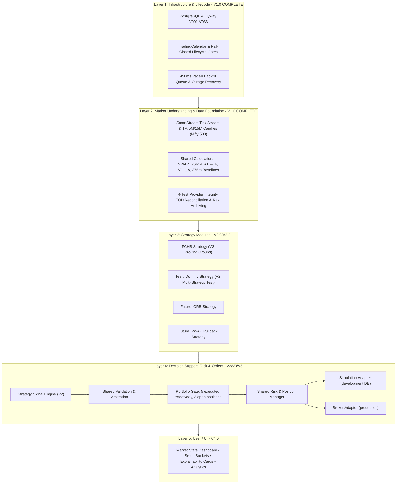
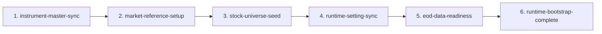
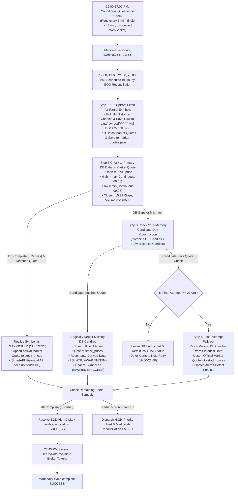

# Market Scanner Architecture & Workflow Guide (`project_workflow.md`)

This document is the authoritative developer, tester, and architecture guide for Mithron. It tracks the complete, chronological end-to-end application lifecycle from data foundation to strategy evaluation, risk-integrated historical backtesting, interactive trader UI, real-time order execution, and small-capital live trading.

---

### Master Version Scope Boundaries

- **Version 1.0 (Data & Market Lifecycle Foundation - COMPLETE ✅):**
  - **Phase 1:** Application Bootstrapping & Startup Readiness (6 fail-closed stages).
  - **Phase 2:** Daily Pre-Market Pipeline (07:00 AM Maintenance, 08:00 AM Data Preparation, 08:50 AM EOD Catchup Cutoff, 08:55 AM Live Start Gate).
  - **Phase 3:** Live Market Ingestion & Intraday Gap Repair (08:55 AM to Post-Market Quiescence, 450ms Paced Queue Worker across Nifty 500).
  - **Phase 4:** Shared Calculation & Common Indicator Engine (VWAP, Wilder's RSI-14, ATR-14, VOL_X, Baselines, Candle Structure).
  - **Phase 5:** Post-Market Feed Shutdown, Raw Broker Disk Archiving, 4-Test Provider Integrity EOD Reconciliation, Alerting & Session Teardown.
  - **Runtime Developer Tools:** Swagger OpenAPI Inspector, Authenticated SmartAPI Proxy (`/broker/smartapi/proxy`), On-Demand EOD Reconciliation.
  - **Verified State:** 321 unit tests passing (100%), 500-stock daily accumulation running live.

- **Version 2.0 (Strategy Intelligence, Institutional Hardening & Multi-Broker Replay - COMPLETE ✅):**
  - **V2.0: Architecture & Domain Contracts:** Canonical `MarketContext` (Master Market Filter: Binary Nifty VWAP evaluated on 5M candle closes; recoverable mid-session crosses; macro regimes deferred), `Strategy`, `StrategyEvaluation`, `StrategyProposal`, `StrategySignal`, parameter versioning, and deprecation/removal of legacy prototype code.
  - **V2.1: Evaluation Infrastructure & In-Memory Cache:** 5-minute candle close evaluation cadence (09:30–01:00 PM), in-memory `StockContextCache` across Nifty 500 (eliminating DB I/O bottleneck), fail-closed checks on active gap repair/backfill.
  - **V2.2: FCHB Strategy Module & Position Handler:** First 5-minute candle (09:15–09:19 AM) reference building, 7-Gate Red/Yellow/Green Traffic-Light Quality Gate (RSI gate permanently removed to allow institutional runners to expand), 5M signal detection (`BO_% <= 0.8%`, `VOL_X >= 1.8`, 15M trend alignment, candle body >= 0.60, upper wick <= 0.25). Decoupled `FchbPositionHandler` with 6-tier technical exit hierarchy: 14:55 hard close, 14:45 wind-down, real-time tick SL, Target 1 (+0.73R) partial exit with immediate breakeven lock, 5M candle invalidation rules (failed breakout cut at -0.5R, VWAP breakdown cut at -0.5R, momentum exhaustion cut), and clean 1.0R/0.73R dual-leash trailing stop.
  - **V2.3: Portfolio Risk Engine, Multi-Broker Accounting & 23-Day Replay Validation:** 5-Phase `RiskEngine` pipeline with strictly 1 entry per stock per day, Strategy-Level Limits (max 5 trades/day, max 3 losses cooling off; static 3 concurrent positions cap permanently removed), 4.0% daily loss shield. Multi-broker statutory charges engine (`BrokerChargesCalculator`) supporting Kotak Neo Zero-Brokerage (`BrokerModel.KOTAK_NEO`) and Angel One. Replayed across 23 historical sessions on 499 stocks: 53 trades, 62.3% win rate, Profit Factor 1.91, +10.69% Net Return. Empirical audit confirmed 14:45 wind-down captures +₹1,087.55 more Gross P&L (+₹1,394.73 Net) than 14:15.
  - **V2.4: Live Data Simulation Order Engine (Production Paper Trading Conductor - CURRENT ACTIVE MILESTONE):**
    * V2.4.1: Sector Indices Infrastructure & Stock-to-Sector Classification (`stock_sector_classification` table, dynamic NSE scraper/seeder, WebSocket multi-index subscription).
    * V2.4.2: Real-Time Market Data Ingestion Hooks & `StockContext` Enrichment (direct `onCandleFinalized` hook, instant sector/benchmark metrics).
    * V2.4.3: Decoupled Order Engine Core & Concurrency Safety (`OrderExecutionService`, `SimulatedOrderAdapter`, per-strategy mode, per-symbol locks).
    * V2.4.4: In-Flight Position Management, Signal Conductor & Exit Execution (5M setup conductor, live tick SL/T1 exit dispatching).
    * V2.4.5: Context-Rich Database Persistence ("Data Gold Mine" capturing MFE, MAE, trailing history JSON, Kotak Neo statutory charges).
    * V2.4.6: Diagnostic & Operational REST APIs (`/api/v1/simulation/*` endpoints).

- **Version 3.0 (Advanced Risk & Research Laboratory):**
  - Extend V2 baseline risk/position management with advanced portfolio controls and risk policies.
  - Expand point-in-time simulation analytics (win/loss, profit factor, drawdown, MFE/MAE, expectancy).
  - Improve failure analysis and compare versioned strategy behavior over larger historical samples.

- **Version 4.0 (Professional Web UI & Trader Dashboard):**
  - Live Market State & Nifty 500 Universe Overview.
  - Strategy Setup Buckets & Live Signal Cards with "Why is this stock here?" explainability.
  - Interactive Backtest Explorer & Strategy Analytics Charts.
  - Trade Plan Visualizer (Entry Zone, Stop, Target, Risk %).
  - Stock Search & History Timeline.

- **Version 5.0 (Trading Engine & Order Execution - SmartAPI):**
  - SmartAPI Order Service: `placeOrder`, `modifyOrder`, `cancelOrder`.
  - Live synchronization: Order Book, Trade Book, and Position Book.
  - Live execution integration with Risk Engine (Hard Daily Loss cutoff, Max Exposure, Kill Switch).
  - Order Lifecycle Audit Trail (`PROPOSED` $\to$ `SUBMITTED` $\to$ `FILLED` $\to$ `CLOSED`).

- **Version 6.0 (Small-Capital Live Trading & Paper/Live Toggle):**
  - Paper Mode vs Live Mode toggle.
  - Live execution with small real capital on proven strategies.
  - Production vs Backtest validation.

### Status Legend
- `[IMPLEMENTED + TESTED]`: Complete, verified in code, database, and test suite (411 unit & integration tests passing).
- `[PLANNED]`: Architectural design finalized, scheduled for upcoming version release.

---

## Strategy Lifecycle and Promotion Pipeline

Each versioned strategy advances through three explicit operating stages:

```text
Stage 1: Historical simulation on copied production data (Local development database)
        -> Evaluates exact paper trading pipeline across historical candle sequences
        -> Evidence review, rule defect analysis, and version calibration
Stage 2: Live-market paper trading (Production or staging environment, no real orders)
        -> Real-time operational verification during live market hours (09:15-15:30)
Stage 3: Controlled production trading (Real broker orders via SmartAPI)
        -> Real capital deployed with small size on validated setups
```

### Shared Engine Architecture: Simulation as Fast-Forward Paper Trading
- **100% Identical Workflow & Code Paths:**
  - Historical simulation in the local development database runs the **exact same paper trading workflow** as live market hours.
  - Both stages share:
    1. The identical strategy decision pure functions (`Strategy.evaluate(StockContext, MarketState)`).
    2. The identical Traffic-Light Quality Gate (Red / Yellow / Green matrix).
    3. The identical position and trailing stop handlers (`StrategyPositionHandler.evaluatePosition(...)`).
    4. The identical risk gate and portfolio state machine (`RiskEngine` with `PortfolioState(PAPER)`).
    5. The identical simulated execution adapter (`SimulatedTradeExecutionAdapter`), writing to the identical tables (`simulated_signals`, `simulated_orders`, `simulated_positions`).
- **The Only Difference is the Event Driver / Clock:**
  - **Live Paper Trading:** Time is driven by the real-time system clock, live WebSocket binary ticks, and scheduled 1M/5M candle boundary events.
  - **Historical Simulation:** Time is driven by a fast-forward historical replay driver that feeds finalized historical candles bar-by-bar into the exact same orchestrator, simulating fills at the next candle open.
- **Why This Matters (Zero Code Drift):**
  - Eliminates the classic quantitative trap of maintaining a separate "backtester" codebase in Python or custom scripts that drifts from the live execution bot.
  - A strategy validated in historical simulation on dev DB is guaranteed to execute identically in live-market paper trading.
  - The developer can copy historical candle data from production into the local development database, run extensive simulations across 30+ session days, inspect the resulting `simulated_*` records and `rule_context` JSON audit snapshots, and iterate safely with zero risk to production data or real broker sessions.

---

## 5-Layer System Architecture



---

## Phase 1: Application Bootstrapping & Startup Readiness `[IMPLEMENTED + TESTED]`

**Purpose:** Orchestrated by `RuntimeBootstrapService`, executes a fail-closed 6-stage sequence upon initial application launch. Startup records in `workflow_status` have `process_date = NULL`.



### Stage Details
1. **`instrument-master-sync`:** Downloads Angel One instrument catalog, populates `instrument_master`, verifies `NIFTY/NSE` exists.
2. **`market-reference-setup`:** Ensures `NIFTY/NSE` is configured as an active `INDEX` in `instrument_master`.
3. **`stock-universe-seed`:** Reads selected symbols from CSV, resolves each against `instrument_master` as the single source of truth, and seeds `stock_universe` (`is_active = true`, `is_tradable = false`).
4. **`runtime-setting-sync`:** Verifies and auto-heals 16 required configuration parameters in `runtime_setting`.
5. **`eod-data-readiness`:** Verifies verified EOD data exists for the **previous official trading day**. On fresh databases, seeds initial baseline `EodDataEntry` records.
6. **`runtime-bootstrap-complete`:** Performs a read-only token readiness check verifying non-blank broker tokens exist for all active stocks and `NIFTY`.

---

## Phase 2: Daily Pre-Market Pipeline `[IMPLEMENTED + TESTED]`

**Purpose:** Automated morning pipeline tracked in `workflow_status` (`workflow_group = "pre-market"`, `process_date = YYYY-MM-DD`). Orchestrated by `PreMarketWorkflowService`.

### Stage Details
1. **07:00 AM Morning Maintenance:**
   - **`trading-day-init`:** Queries `TradingCalendar` (`holiday_calendar` DB is single source of truth). If holiday/weekend, stops cleanly. If trading day, sets `runtime.process.date = today` and marks `SUCCESS`.
   - **`premarket-housekeeping`:** Purges data older than retention settings and clears memory caches.
2. **08:00 AM Pre-Market Data Preparation:**
   - **`premarket-catalog-sync`:** Downloads master catalog (143k scrips), maps 2,747 NSE Cash instruments & NIFTY (`99926000`), authenticates broker session early, and verifies broker tokens directly from DB.
   - **`premarket-universe-sync` (current behavior):** Reconciles active universe. Checks `eod_data_entry` for the previous trading day; if missing/incomplete for any symbol, demotes `is_tradable = false` while keeping `is_active = true`.
   - **Planned tradability rule:** Keep new symbols false by default. Set `is_tradable = true` only when EOD is complete and `stock_prices` contains at least the previous 20 official trading days; if the previous trading day EOD is incomplete, set false. This flag represents current data-integrity/export eligibility.
   - **`premarket-morning-reference`:** Authoritative computation of CPR, ADR, 15-day resistance, 20-day ADV, and 375m volume baseline curves for previous trading day into `DailyStockContext`.
3. **08:55 AM Live Start Gate & 09:10 AM Pre-Market Uncrossed Price Lock:**
   - **`premarket-live-start`:** Strictly verifies all 5 prior daily steps are `SUCCESS` for today's date before connecting the WebSocket and starting the `market-hours` stage.
   - **09:08-09:10 AM Pre-Market Price Locking:** Order uncrossing concludes by 09:08:00 AM (price frozen 09:08:00 to 09:14:59). The last tick price received for the 09:08 candle defines the uncrossed equilibrium price. By 09:10 AM, the `09:08:00` pre-market candle in `market_candles` is locked with $\text{Open} = \text{High} = \text{Low} = \text{Close} = \text{uncrossed price}$. All downstream gap analysis and daily context tables consume this canonical Day Open price.

---

## Phase 3: Live Market Ingestion & Intraday Gap Repair `[IMPLEMENTED + TESTED]`

**Purpose:** Connects to Angel One SmartStream WebSocket, ingests real-time binary ticks, constructs canonical 1-minute candles, tracks feed health, and triggers live gap repair.

### Workflow & Ingestion Rules
1. **08:55 AM - Pre-Open Feed Connect:** Connects WebSocket and subscribes to active universe equities and `NIFTY`. Ignores pre-09:08 order collection ticks to prevent stale data pollution.
2. **09:15 AM - Market Open Event:** Continuous session begins. VWAP resets strictly to 0. Day Type latched at 09:15 (`GAP_UP` > +0.75%, `GAP_DOWN` < -0.75%, `NORMAL`) using the 09:08 uncrossed Day Open.
3. **Continuous Binary Tick Processing:** `AngelOneTickParserService` decodes high-throughput packets; deduplicates duplicate ticks.
4. **1-Minute Candle Construction & DB Persistence:** `LiveMarketCandleService` accumulates ticks into 1M bars ($xx:xx:00 \dots xx:xx:59$), persists to `market_candles`, and updates `market_minute_snapshot`. Active symbols roll over immediately on the first tick of minute $T+1$; a background scheduled sweep at `:10` seconds past the minute finalizes any quiet/illiquid symbols directly from in-memory accumulators.
5. **Real-Time Gap Detection & Continuous Queue Worker Backfill:** Missing minute detected $\rightarrow$ enqueues job into `BackfillQueueService`. The background daemon worker continuously drains jobs at a paced rate of **450ms**, retrying temporary broker API limits, and confirming un-traded minutes as `NO_TRADE_CONFIRMED` upon retry exhaustion to release provisional ranges and unblock symbols cleanly.
6. **15:30 Market Close Policy:** Ingestion continues until post-16:00 to capture post-market settlement ticks.

---

## Phase 4: Shared Calculation & Common Indicator Engine `[IMPLEMENTED + TESTED]`

**Purpose:** Shared facts are calculated once and stored on canonical candle models to prevent calculation drift.

### Validation Standards:
1. **RSI-14 (Wilder's Smoothing):** Requires $\ge 42$ consecutive clean 1M candles of today. Stored on 1M, 5M, 15M. Within 0.1 points vs TradingView.
2. **ATR-14 (Wilder's Smoothing):** Requires $\ge 14$ consecutive clean 1M candles of today + authoritative `prevDayClose`. Within Rs. 0.05 vs TradingView.
3. **VWAP & Derived Metrics:** Cumulative $(\text{TP} \times \text{volume}) / \sum(\text{volume})$. Resets strictly at 09:15 AM. Evaluates `niftyAboveVwap`, `niftyVwapDirection`, and `vwapProximityPct`.
4. **Volume Baselines & Runtime VOL_X:** 20-day ADV and 375 session-minute baseline curves. Requires $\ge 20$ completed trading days.
5. **Candle Structure & Quality Flags:** Zero-range guard, body ratio, upper/lower wick ratios, range percentage, and strong bullish/bearish classification.

---

## Phase 5: Post-Market Shutdown, Archiving, EOD Reconciliation & Teardown `[IMPLEMENTED + TESTED]`

**Purpose:** Quiescence shutdown, upfront raw historical REST archiving, DB-first authoritative comparison against Market Quote, surgical in-memory candidate repair, 375-minute candle reconciliation, alert management, and daily session teardown.



---

## Strategy & Decision Roadmap Ahead: Version 2.0 to Version 6+ `[PLANNED]`

### Complete Version 2 Implementation Plan: Strategy Intelligence & First Strategy Vertical Slice (FCHB)

V2 delivers one strategy (**FCHB - First Candle High Breakout**) through historical simulation and live-market paper trading. It establishes Mithron's **canonical decision language**, proving the complete pipeline from market context to signals, validation, arbitration, trade gating, and audit logging before any real-money order execution is enabled.

---

#### 1. Architectural Core & Guiding Principles

- **Vertical Slice Delivery:** Deliver FCHB end-to-end to validate the entire decision language and pipeline (Context $\to$ Strategy $\to$ Validator $\to$ Arbitration $\to$ Audit Trail) rather than building half-finished pieces of multiple strategies.
- **Separation of Concerns:** Strategies are pure decision functions (`pure functions`). They **never** fetch database records, invoke broker APIs, or calculate shared indicators. They consume finalized context and emit immutable proposals.
- **Fail-Closed Safety:** If data is missing, if a backfill job is active for the symbol, if market hours are violated, or if indicators are unready, evaluation immediately fails closed (`NOT_EVALUABLE` / `REJECTED`).

---

#### 2. V2.0 — Architecture Decisions, Domain Contracts & Legacy Retirement `[RETIREMENT COMPLETE ✅]`

- **Canonical Domain Models:**
  - `MarketContext`: Root context encapsulating macro `MarketState` (NIFTY regime) and micro `StockContext` (500 equities).
  - `MarketState`: Captures master market filter state (`ACTIVE` vs `SUSPENDED`) based on NIFTY 5M VWAP status.
  - `StockContext`: In-memory container providing pre-market baselines, opening reference candle, sliding windows of 1M, 5M, and 15M candles, current prices, and pre-calculated indicators.
  - `Strategy`: Pure interface `evaluate(StockContext, MarketState, StrategyParameters) -> StrategyEvaluation`.
  - `StrategyEvaluation`: Evaluation outcome (`QUALIFIED`, `NOT_QUALIFIED`, `NOT_EVALUABLE`), proposal details, confidence score, and explicit `passedConditions` and `failedConditions` lists.
  - `StrategyProposal`: Symbol, strategyId, direction (`LONG`), entry price, initial stop loss, target 1, target 2, structural invalidation level, and confidence score.
  - `StrategyValidator`: Fail-closed gatekeeper interface checking data readiness, trading windows, and structural limits.
  - `ValidationResult`: Gatekeeper output (`APPROVED` vs `REJECTED`) with specific failure code.
  - `TradeCandidate`: Deduplicated and validated signal candidate ready for portfolio arbitration.
  - `TradeIntent`: Portfolio-level accepted trade candidate with sizing, protective stop plan, and execution parameters.
  - `SignalAudit`: Immutable persisted record containing timestamp, symbol, strategy ID, parameter snapshot (JSON), evaluated conditions, and disposition.
- **Legacy Prototype Retirement `[COMPLETED ✅]`:**
  - Deprecated and removed obsolete prototype classes: `LiveSignalService`, `LiveSimulationSignal`, `BreakoutSignalEvaluator`, `BreakoutSignalGenerator`, `SignalGenerator`, `RuleExecutionPolicyService`, `StrategyScoringService`, `StrategyCatalogService`, `StrategyYamlDefinition`, `ScoreDecision`, and all legacy YAMLs.
  - Decoupled `LiveMarketCandleService`, `RuntimeAdminController`, `RuntimeHousekeepingService`, and `RuntimeReadinessService`.
  - Maintained 100% test pass rate across all 318 active unit and integration tests.

---

#### 3. V2.1 — Master Market Filter & Evaluation Infrastructure `[COMPLETED + TESTED ✅]`

- **Strategy-Agnostic Master Market Filter (`MasterMarketFilterService`):**
  - **Concept:** Evaluates objective macro market facts rather than a rigid, opinionated gate. Supports Long, Short, and Market-Neutral strategies simultaneously.
  - **Macro Facts Emitted:**
    - `niftyClose`: Last finalized 5M NIFTY close price.
    - `niftyVwap`: Corresponding 5M NIFTY VWAP.
    - `vwapDistancePct`: Distance between NIFTY close and VWAP (`((close - vwap) / vwap) * 100`).
    - `niftyAboveVwap`: Boolean flag (`true` if close > VWAP).
    - `regime`: `MarketRegime` enum (`BULLISH`, `BEARISH`, `NEUTRAL`, `UNKNOWN`).
    - `dataValid`: Fail-closed validity flag (`false` before 09:20 AM, after 01:00 PM cutoff, or if NIFTY candles/VWAP are uncalculated).
  - **Strategy Consumption:**
    - **Long Strategies (FCHB):** Check `niftyAboveVwap == true` (or `regime == BULLISH`).
    - **Future Short Strategies:** Check `!niftyAboveVwap` (or `regime == BEARISH`).
    - **Market-Neutral Strategies:** Can operate independently of NIFTY VWAP alignment.
  - **Evaluation Cadence & Mid-Session Recovery:**
    - Evaluated strictly on **5M candle closes** (09:20 AM to 01:00 PM cutoff).
    - If NIFTY closes below VWAP mid-session, long setups pause for that 5M window. If NIFTY re-crosses above VWAP before 01:00 PM, long setups recover automatically. The day is never prematurely killed.

- **High-Performance In-Memory Sliding Cache (`StockContextCache`):**
  - **Design Goal:** Maintain sliding candle windows (last 30 1M bars, 75 5M bars, 25 15M bars) and session anchors across 500 stocks in RAM, eliminating 1,500+ database reads at every 5-minute evaluation sweep.
  - **Memory Footprint:** Less than 35 MB total across all 500 active stocks (utilizing < 0.3% of the host system's 16 GB RAM).
  - **Lock-Free Reads (Zero Thread Contention):**
    - Sliding windows are encapsulated in `AtomicReference<List<MarketCandle>>` snapshots.
    - Strategy evaluation calls obtain an unmodifiable snapshot in 0 nanoseconds with **100% lock-free reads**, preventing micro-stalls even during intense concurrent WebSocket tick bursts.
  - **Zero-DB Backfill Status Tracking:**
    - Replaced per-symbol `backfillJobRepository` queries with an in-memory thread-safe `Set<String> activeBackfillSymbols`.
    - Checking if a symbol is under active gap repair resolves in 0 ms via in-memory set lookup, reducing DB query overhead from 500 queries down to 0 during evaluation.
  - **Crash Recovery & Morning Warm-Up:**
    - Supported by `warmUp(tradingDate, symbols, exchange)`. On application startup or post-crash restart, preloads today's finalized candles and daily stock context directly from PostgreSQL in 2–3 seconds.
    - Automatic multi-day cache clearance on trading day transitions.

---

---

#### 4. Immediate Production Reliability & Hygiene Fixes `[COMPLETED + TESTED ✅]`

Two production edge cases discovered during live market feed monitoring were remediated and verified under the `version-2.1` branch baseline:

1. **WebSocket Connection Timestamp Reset (`AngelOneWebSocketService`):**
   - **Issue:** On overnight quiescence or intentional disconnect, `lastMessageReceivedAt` retained yesterday's timestamp. When the morning connection was established at 08:55 AM, the scheduled alert monitor computed an elapsed idle duration of > 1,000 minutes and triggered a false-positive `runtime.stale_ticks` HIGH severity alert email.
   - **Resolution:** Explicitly reset `lastMessageReceivedAt = timeProvider.nowDateTime()` inside `connect()` (and on `disconnect()`). Added unit test in `AngelOneWebSocketServiceTest.java`.
2. **Workflow Stage Transition Race Condition (`PreMarketWorkflowService` & `RuntimeAutomationService`):**
   - **Issue:** During pre-market startup, `connectAndSubscribe()` attempted to mark `market-hours` as `RUNNING` while its dependency (`premarket-live-start`) was still in status `RUNNING`, triggering a dependency warning and leaving `market-hours` in status `READY`.
   - **Resolution:** Removed the premature transition call from inside `connectAndSubscribe()`. Instead, `premarket-live-start` cleanly marks itself `SUCCESS`, and `RuntimeAutomationService` transitions `market-hours` to `RUNNING` as its official dependent next step. Updated `PreMarketWorkflowServiceTest.java`.
3. **Verification:** Both fixes verified across the complete test suite: **327 passing unit tests (100% pass rate)**. Deployed as part of the unified Version 2 release.

---

#### 5. V2.2 — First Candle High Breakout (FCHB) Strategy Slice: Entry & Position Rules `[COMPLETED + TESTED ✅]`

Strategies operate as **pure decision functions**, decoupled from application timers, database repositories, or broker APIs. Each strategy slice provides two distinct, single-responsibility components: **Signal Evaluation** (entry decisions) and **Position Handling** (exit decisions).

##### A. Long vs. Short Strategy Decoupling:
- **Decision:** Long strategies (`FchbStrategy`) and Short strategies (`FclbStrategy` - First Candle Low Breakdown) are implemented as **separate classes**.
- **Rationale:**
  1. *Asymmetric Market Physics:* Downside selloffs are high-velocity, fear-driven, and volatile; upside rallies are accumulation-driven and grinding. Indicator thresholds, pullback depths, and wick tolerances cannot be symmetrically mirrored.
  2. *Intraday Short Regulatory Constraints:* Short positions in Indian equities require mandatory MIS intraday tagging with strict 03:15 PM broker auto-square-off, whereas delivery/CNC allows different leeway.
  3. *Code Hygiene:* Combining long and short into a single class creates complex conditional branching, increasing regression risks and degrading maintainability.

##### B. Signal Evaluation (`FchbStrategy`):
- **Contract:** Implements pure interface `Strategy.evaluate(StockContext, MarketState) -> StrategyEvaluation`.
- **First Candle Reference Building (09:15 to 09:19 AM):**
  - Aggregates the five finalized 1M candles: 09:15, 09:16, 09:17, 09:18, 09:19.
  - `firstCandleOpen = open of 09:15 candle`
  - `firstCandleHigh = max(high) across all 5 candles`
  - `firstCandleLow = min(low) across all 5 candles`
  - `firstCandleClose = close of 09:19 candle`
  - `firstCandleVolume = sum(volume) across all 5 candles`
  - `firstCandleRangePct = (firstCandleHigh - firstCandleLow) / firstCandleLow * 100`
  - `firstCandleBullish = firstCandleClose > firstCandleOpen` (strictly green)
- **First Candle Quality Gate (if any condition fails $\to$ FCHB suspended for symbol today):**
  1. `firstCandleRangePct >= 0.15%` and `<= 3.0%` (guards against dead opens and unmanageably wide stops).
  2. `firstCandleBullish == true` (positive opening sentiment required).
  3. All 5 1M candles present and finalized in cache.
  4. `firstCandleTurnover >= ₹1,00,00,000` (₹1 Crore): $\text{Volume} \times \frac{H+L+C}{3} \ge 10,000,000$. Replaces rigid share-count floor; price-agnostic liquidity proof.
- **Two-Factor Volume Model (Institutional Normalization):**
  - **Factor A (Mandatory Hard Gate):** Time-normalized $\text{VOL\_X} \ge 1.8\times$ (relative to 20-day historical baseline curve for this exact 5M interval). If fails $\to$ **RED** (Disqualified).
  - **Factor B (Time-Weighted Quality Gate — YELLOW Factor Only):**
    - 09:30 to 09:45 IST: $\text{Signal Volume} \ge 1.5\times \text{Candle 1 Volume} \implies \text{GREEN}$; $\ge 1.0\times \implies \text{YELLOW}$; $< 1.0\times \implies \text{Extra YELLOW}$.
    - 09:45 to 13:00 IST: $\text{Signal Volume} \ge 0.75\times \text{Candle 1 Volume} \implies \text{GREEN}$; $\ge 0.50\times \implies \text{YELLOW}$; $< 0.50\times \implies \text{Extra YELLOW}$.
    - *Rationale:* Protects against the U-shaped midday volume dip without ignoring opening auction participation.
- **Traffic-Light Quality Gate (Red / Yellow / Green Matrix):**
  - Replaced opaque 0–100 numerical scoring with deterministic 7-gate traffic-light evaluation:
    - **RED (Hard Disqualification - 0 Permitted):** Extension $> 0.8\%$, VOL_X $< 1.8$, Nifty $<$ VWAP, Nifty Gap $\ge 0.75\%$ (Day suspended), first candle bearish, post-volatile day $> 4.0\%$, circuit room $< 2.0\%$, stock gap $> 1.5\%$.
    - **YELLOW (Marginal Setup):** Extension $0.4\% - 0.8\%$, Factor B volume ratio yellow tiers, Nifty close barely above VWAP ($< 0.30\%$).
    - **GREEN (Textbook Prime Setup):** Extension $0.0\% - 0.4\%$, VOL_X $\ge 2.5$, Factor B volume ratio green tiers, Nifty close $> 0.30\%$ above VWAP, 15M trend strongly aligned, strong bullish candle (`bodyRatio >= 0.65`, `upperWickRatio <= 0.15`).
  - *RSI Gate Retired:* RSI was permanently removed from FCHB traffic lights because institutional momentum breakouts routinely push 5M RSI > 70 in morning expansion; penalizing RSI > 72 was choking elite winning trades.
  - **Trade Quota Quality Rules:**
    - **Trades 1, 2, 3:** Maximum 2 YELLOW conditions permitted, 0 REDs.
    - **Trades 4, 5:** MUST BE ALL GREEN (0 REDs, 0 YELLOWs). Because earlier trades have utilized daily risk capacity, late-session trades demand flawless textbook execution.
- **Pre-Market Day Open Resilience & Outage Recovery:**
  - Day Open is defined by the 09:08:00 uncrossed pre-market price.
  - If a feed disconnection occurs between 09:00 and 09:14:
    - NEVER default to the continuous 09:15 candle open (09:15 open contains continuous order book imbalances).
    - If `open` is null or zero in `DailyStockContext` / `stock_prices`, the pre-market pipeline calls Angel One SmartAPI **Market Quote API** (`GET /rest/secure/angelbroking/market/v1/quote`) during 09:10–09:14 to retrieve the official opening price.
- **Strategy Parameter Architecture: YAML Baselines + DB Overrides:**
  - Default parameters defined in version-controlled YAML (`config/strategies/fchb_strategy.yaml`).
  - Synced to `strategy_rule_value` DB table on bootstrap.
  - Dynamically editable at runtime in PostgreSQL without redeploying code.
  - Evaluated values snapshotted into JSON in `signals.rule_context`.

##### C. Strategy-Specific Position Handler (`FchbPositionHandler`):
- **Contract:** Implements `StrategyPositionHandler.evaluatePosition(Position, LiveMarketSnapshot) -> PositionAction`.
- **Target 1 Calibration (+0.73R Non-Round Anchor):**
  - Formulated as `targetPrice = PriceTickUtil.roundTarget(close + (0.73 * riskPerShare), false, 0.05)`.
  - Exiting 50% at +0.73R locks in $+0.365R$ gross profit on leg 1, absorbing all round-trip statutory charges and broker fees with net positive cash locked in, immediately ratcheting stop loss to Entry (Breakeven).
- **Exit Logic & Priority Order:**
  - **Priority 1 (14:55:00 Hard Close):** Unconditional market exit across all positions (broker RMS square-off shield).
  - **Priority 2 (14:45:00 Wind-Down Cutoff):** Conditional exit if unratcheted (LONG: $\text{SL} < \text{Entry} - ₹0.05$; SHORT: $\text{SL} > \text{Entry} + ₹0.05$) $\to$ full exit; if ratcheted $\ge$ breakeven $\to$ trail runner until 14:55:00.
  - **Priority 3 (Stop Loss Hit):** Real-time tick breach (LONG: $\text{LTP} \le \text{SL}$; SHORT: $\text{LTP} \ge \text{SL}$) $\to$ full exit.
  - **Priority 4 (Target 1 Partial Exit):** LTP hits +0.73R (LONG: $\text{LTP} \ge \text{Target 1}$; SHORT: $\text{LTP} \le \text{Target 1}$) $\to$ exit 50% at market, lock stop at entry (breakeven).
  - **Priority 5 (Completed 5M Candle Invalidation Rules):**
    - *Failed Breakout Cut:* 5M close < FCH and <= Entry - 0.50R $\to$ full exit at -0.5R.
    - *VWAP Breakdown Cut:* 5M close < VWAP and <= Entry - 0.50R $\to$ full exit at -0.5R.
    - *Momentum Exhaustion Cut:* 5M EMA9 < EMA21 and close < Entry $\to$ full exit.
  - **Priority 6 (Dynamic Dual-Leash Trailing Stop):**
    - *Pre-Target 1:* Stop trails with 1.0R leash behind peak (`peak - 1.0R`), cutting risk in half as price rises to +0.50R without premature breakeven shakeouts.
    - *Post-Target 1:* Runner trails with 0.73R leash behind peak (`peak - 0.73R`). Monotonic enforcement guarantees stops never retreat.

---

#### 6. V2.3 — Portfolio Risk Engine, Dynamic Capital Management & Position Manager `[COMPLETED + TESTED ✅]`

##### Complete Institutional Hardening & Architecture Matrix

| # | Category | Institutional Problem & Vulnerability | Files Modified / Added | Implemented Resolution & Validation |
|---|---|---|---|---|
| **1** | **Universal Directionality** | Sizing, P&L, downside risk, trailing stops, and invalidation assumed `LONG` only. A `SHORT` trade resulted in negative shares, inverted ratchets, and crash. | `PortfolioState.java`, `RiskEngine.java`, `PositionManagerService.java`, `FchbPositionHandler.java` | **Side-Aware Geometry:**<br>• Downside risk: $(E - SL) \times Q$ for LONG; $(SL - E) \times Q$ for SHORT.<br>• P&L: $(P - E) \times Q$ for LONG; $(E - P) \times Q$ for SHORT.<br>• Monotonic ratcheting: strictly upward for LONG ($\ge$), strictly downward for SHORT ($\le$).<br>• Dynamic thresholds for Target 1, breakeven (+0.8R), and milestone floors (+2R, +3R) fully side-aware. |
| **2** | **Dynamic Capital & Sizing** | Static starting capital assumption; committed margin not reserved for subsequent trades; concurrent signals blind to remaining buying power. | `PortfolioState.java`, `RiskEngine.java`, `AngelOneApiExecutor.java`, `AngelOneMarketDataProvider.java` | **Real Available Margin & Smart Downsizing:**<br>• Authoritative available margin: $\text{AvailableMargin} = \min(\text{LiveBrokerCash}, \text{RAM Cash} - \text{CommittedMargin})$.<br>• If standard 1% risk quantity requires $> \text{AvailableMargin}$, dynamically downsize quantity to buying power.<br>• **3x Friction Safety Filter:** Downsizing permitted only if $Q \ge 2$ shares AND expected $1R \ge 3 \times \text{Friction}$. Otherwise, cleanly rejected with `"EXCESSIVE_FRICTION_DRAG"` rather than entering a churn-loss trade. |
| **3** | **Open Downside Risk** | Gate 2 evaluated only closed `realizedPnl`. Multiple open positions could gap against stops simultaneously, destroying daily max loss (-4%). | `PortfolioState.java`, `RiskEngine.java` | **Worst-Case Loss Gate:**<br>• Gate 2 strictly checks: $\text{realizedPnl} - \text{openRisk} \le -4.0\% \times \text{StartingCapital}$.<br>• If existing open positions plus proposal risk breach daily loss limit, new proposals are immediately rejected (`"MAX_DAILY_LOSS_BREACHED"`). |
| **4** | **Serialized Intake Gateway** | Concurrent candidate signals evaluated and placed orders in parallel threads, causing double-allocation races and margin rejections. | `OrderExecutionGateway.java` (New), `RiskEngine.java` | **Single-Writer Execution Mutex:**<br>• `OrderExecutionGateway` synchronizes candidate proposal evaluation and order submission through a dedicated execution mutex.<br>• Locks symbol in `RiskEngine` upfront, verifies capital, places fill, records in `PortfolioState`, and unlocks symbol on completion or failure.<br>• Position management retains fine-grained per-symbol concurrency for real-time tick monitoring. |
| **5** | **Zero Blind Trust in RAM** | In-memory prices and fee estimates diverge from actual exchange execution; structural stop adjusted on slippage causes risk distortion. | `PositionManagerService.java`, `AngelOneMarketDtos.java`, `AngelOneMarketDataProvider.java` | **Authoritative Broker Synchronization:**<br>• Live RMS margin sync via `GET /rest/secure/angelbroking/user/v1/getRMS`.<br>• Live Trade Book reconciliation via `GET /rest/secure/angelbroking/order/v1/getTradeBook`.<br>• `recordBrokerFill`: Structural invalidation stop remains **strictly fixed** to analytical chart level; entry price, actual downside risk, and targets dynamically re-anchor to broker fill price. |
| **6** | **EOD Square-Off** | Illiquid stocks with zero ticks past 14:55 leak into broker RMS auto-square-off penalty. | `MarketScheduler.java`, `PositionManagerService.java`, `FchbPositionHandler.java` | **Active 30s Scheduled Hard Close Sweep:**<br>• `MarketScheduler.scheduledEodHardCloseSweep()` runs every 30s between 14:55:00 and 15:15:00 IST.<br>• Forces market exits on all remaining open positions using latest known LTP snapshot from `LiveMarketSnapshotService`.<br>• Cancel-Resting-Orders-First protocol guarantees no conflicting resting orders. |
| **7** | **Crash Recovery** | Mid-day application restart loses active in-memory positions, causing abandoned positions without trailing stops. | `StartupRecoveryService.java`, `PositionManagerService.java` | **Startup Active Position Rehydration:**<br>• `StartupRecoveryService.recoverNow()` invokes `positionManagerService.rehydrateActiveState(...)` on application boot, restoring active positions, ratcheted stops, and daily trade quotas directly into RAM and RiskEngine. |
| **8** | **Lifecycle & Morning Reset** | Traded symbol locks and trade quotas carry over to next trading day if app is not restarted. | `PreMarketWorkflowService.java`, `RiskEngine.java`, `PositionManagerService.java` | **Premarket Clean Reset & RMS Capital Anchor:**<br>• Stage 1 (`trading-day-init` @ 07:00 AM) resets trade counts and clears symbol locks.<br>• Stage 6 (`premarket-live-start` @ 08:55 AM) pulls live Angel One RMS available cash to anchor the day's baseline capital. |

---

##### Detailed Architectural Breakdown

1. **Universal Dual-Directional Risk & Position Engine:**
   - **RiskEngine Validation (Gate 5):**
     - Symmetrical validation ensures short strategies (`FCLB`, etc.) are treated as first-class citizens alongside long strategies (`FCHB`).
     - For `LONG`: Requires $\text{entryPrice} > \text{initialStopLoss}$ AND $\text{target1Price} > \text{entryPrice}$.
     - For `SHORT`: Requires $\text{entryPrice} < \text{initialStopLoss}$ AND $\text{target1Price} < \text{entryPrice}$.
   - **Side-Aware Downside Risk & Capital Commitment:**
     - `PortfolioState.calculateTotalOpenDownsideRisk()` evaluates total active exposure based on live trailing stops:
       $$\text{Risk}_{\text{LONG}} = (\text{entryPrice} - \text{currentStopLoss}) \times \text{currentQuantity}$$
       $$\text{Risk}_{\text{SHORT}} = (\text{currentStopLoss} - \text{entryPrice}) \times \text{currentQuantity}$$
       $$\text{TotalOpenDownsideRisk} = \sum_{\text{pos} \in \text{openPositions}} \max(0.0, \text{Risk}_{\text{pos}})$$
     - Committed intraday margin per position (accounting for MIS 5x leverage):
       $$\text{Margin}_{\text{pos}} = \frac{\text{currentQuantity} \times \text{entryPrice}}{\text{INTRADAY\_LEVERAGE\_FACTOR}}$$
       $$\text{TotalCommittedMargin} = \sum_{\text{pos} \in \text{openPositions}} \text{Margin}_{\text{pos}}$$
   - **Side-Aware Monotonic Ratcheting:**
     - Trailing stops must strictly move toward profitability and never retreat:
     - For `LONG`: Requires $\text{newStopLoss} \ge \text{currentStopLoss}$ (ratchets UP only).
     - For `SHORT`: Requires $\text{newStopLoss} \le \text{currentStopLoss}$ (ratchets DOWN only).
   - **`FchbPositionHandler` Priority Exit Hierarchy (Side-Aware):**
     1. *Priority 1 (Hard Close):* 14:55:00 unconditional market exit across all positions.
     2. *Priority 2 (Wind-Down Cutoff):* 14:45:00 (14:15:00 on expiry). If unratcheted (LONG: $\text{SL} < \text{Entry}$; SHORT: $\text{SL} > \text{Entry}$) $\to$ full exit; if ratcheted $\ge$ breakeven $\to$ trail until 14:55:00.
     3. *Priority 3 (Stop Loss Hit):* Real-time tick breach (LONG: $\text{LTP} \le \text{SL}$; SHORT: $\text{LTP} \ge \text{SL}$) $\to$ full exit.
     4. *Priority 4 (Structural Invalidation - Fast Cut):* Active only while stop $<$ entry: 1M close (LONG: $\text{Close} < \text{FCH}$; SHORT: $\text{Close} > \text{FCL}$) $\to$ full exit.
     5. *Priority 5 (Target 1 Partial Exit):* LTP hits +1R (LONG: $\text{LTP} \ge \text{Target 1}$; SHORT: $\text{LTP} \le \text{Target 1}$) $\to$ exit 50% at market, lock stop at entry (breakeven).
     6. *Priority 6 (Breakeven Ratchet):* LTP hits +0.8R prior to Target 1 $\to$ ratchet stop to entry price.
     7. *Priority 7 (Target 2 ATR Trailing & Milestone Floors):* Post-Target 1 booked $\to$ milestone floors at $+2R \implies \text{SL at } +1R$, $+3R \implies \text{SL at } +2R$, trailed with $1\text{M Extreme} \pm (0.5 \times 5\text{M ATR})$.

2. **Dynamic Buying Power Accounting & Smart Downsizing with 3x Friction Filter:**
   - **Dynamic Available Margin:**
     $$\text{AvailableMargin} = \min(\text{LiveBrokerCash}, \text{RAM Cash} - \text{CommittedMargin})$$
   - Sizing starts with the standard 1% risk allocation:
     $$\text{RiskPerShare} = |\text{entryPrice} - \text{initialStopLoss}|$$
     $$Q = \left\lfloor \frac{\text{Capital} \times 0.01}{\text{RiskPerShare}} \right\rfloor$$
     $$\text{RequiredMargin} = \frac{Q \times \text{entryPrice}}{\text{LEVERAGE}}$$
   - **Smart Downsizing:** If $\text{RequiredMargin} > \text{AvailableMargin}$, the engine does not immediately reject the candidate if capital is merely constrained. Instead, it computes the maximum shares the remaining buying power can fund:
     $$Q_{\text{downsized}} = \left\lfloor \frac{\text{AvailableMargin} \times \text{LEVERAGE}}{\text{entryPrice}} \right\rfloor$$
   - **3x Friction Safety Filter:** Downsizing is only accepted if the setup remains statistically viable after statutory friction:
     - Minimum share requirement: $Q_{\text{downsized}} \ge 2$ shares (allowing 50% partial exit).
     - Expected 1R Gross Profit: $1R = Q_{\text{downsized}} \times \text{RiskPerShare}$.
     - Conservative round-trip friction (brokerage + STT + exchange + SEBI + GST):
       $$\text{Friction} = 40.0 + (0.0003 \times Q_{\text{downsized}} \times \text{entryPrice} \times 2)$$
     - **Viability Condition:** $1R \ge 3 \times \text{Friction}$. If violated, the trade is rejected with `"EXCESSIVE_FRICTION_DRAG"` to protect the account from high-turnover churn traps.

3. **Total Worst-Case Exposure Gate (Gate 2 Hardening):**
   - Traditional risk engines evaluate only closed realized losses, allowing accounts to suffer severe drawdown if multiple open positions hit stops simultaneously.
   - Mithron's Gate 2 enforces total open downside risk:
     $$\text{WorstCaseLoss} = \text{realizedPnl} - \text{TotalOpenDownsideRisk} - (\text{proposalRisk})$$
     $$\text{WorstCaseLoss} > -0.04 \times \text{StartingCapital} \quad (\text{Max 4% Daily Loss})$$
   - If existing positions plus the new trade would breach the -4% hard threshold upon stop hit, the proposal is immediately rejected with `"MAX_DAILY_LOSS_BREACHED"`.

4. **Single-Writer Serialized Execution Gateway (`OrderExecutionGateway`):**
   - **Concurrence Hazard:** Parallel strategy evaluations firing simultaneous signals could both observe identical available margin, leading to double-allocation and exchange margin rejections.
   - **Single-Writer Gateway Solution:**
     - Signal intake, risk evaluation, symbol lock acquisition, order placement, fill recording, and margin commitment are serialized via a dedicated `executionGatewayMutex`.
     - Symbol is locked upfront in `RiskEngine`.
     - Upon successful broker fill, `positionManagerService.recordBrokerFill(...)` registers the active position.
     - Upon failure or rejection, `riskEngine.unlockSymbol(...)` releases the symbol lock immediately.
   - **Per-Symbol Concurrency Isolation:**
     - While order intake is strictly serialized, live position monitoring utilizes `ConcurrentHashMap<String, Object>` per-symbol locks in `PositionManagerService`.
     - Real-time tick ingestion and trailing stop calculations on TCS never stall or wait for RELIANCE.

5. **Authoritative Broker Synchronization (RMS Margin & Trade Book Execution):**
   - Zero blind trust in RAM data or cached assumptions.
   - Added `RMS_LIMITS` and `TRADE_BOOK` endpoints in `AngelOneApiExecutor` with strict rate limits (1 req/s, 20 req/min).
   - Pre-market Stage 6 (`premarket-live-start`) synchronizes live cash via `GET /rest/secure/angelbroking/user/v1/getRMS`.
   - Post-order execution reconciles exact fill prices (`averagePrice`) from `GET /rest/secure/angelbroking/order/v1/getTradeBook`:
     - Structural invalidation stop remains **strictly fixed** to the analytical chart level.
     - Entry price, actual downside risk, Target 1, Target 2, and breakeven levels dynamically re-anchor to the executed fill price.

6. **Active Scheduled 14:55:00 EOD Hard Close Sweep:**
   - In `MarketScheduler`:
     ```java
     @Scheduled(fixedDelay = 30000)
     public void scheduledEodHardCloseSweep() {
         LocalTime now = timeProvider.nowTime();
         if (now.isAfter(LocalTime.of(14, 55, 0)) && now.isBefore(LocalTime.of(15, 15, 0))) {
             positionManagerService.closeExpiredPositions(PortfolioMode.LIVE, LocalTime.of(14, 55, 0), snapshotService.getLatestTickPrices());
             positionManagerService.closeExpiredPositions(PortfolioMode.PAPER, LocalTime.of(14, 55, 0), snapshotService.getLatestTickPrices());
         }
     }
     ```
   - Sweeps every 30 seconds between 14:55:00 and 15:15:00 IST to ensure illiquid stocks with zero incoming ticks are forcefully exited before Angel One RMS auto-square-off penalties.

7. **Crash Recovery & Active Position Rehydration:**
   - In `StartupRecoveryService`: Invokes `positionManagerService.rehydrateActiveState(...)` on application boot.
   - Restores active positions, ratcheted stop loss levels, and daily executed trade quotas from PostgreSQL into RAM and `RiskEngine`, guaranteeing seamless trailing stop protection across mid-session restarts.

---

##### Four Real-Data Replay Integration Scenarios `[VERIFIED]`
Before advancing to full orchestration, V2.3 validated the Risk Engine and Position Manager against 4 real-world market scenarios captured from production database candles:
1. **Scenario 1 (Strong Bullish Trend Day):** Nifty consistently above VWAP. Multiple stocks trigger FCHB with low/zero YELLOWs; positions hit Target 1 (+1R), ratchet to breakeven, and trail via ATR to multi-R profits.
2. **Scenario 2 (Bearish / Trap Day):** Nifty opens or breaks below VWAP; FCHB signals blocked cleanly by the macro gate.
3. **Scenario 3 (Range-Bound / Choppy Day):** Narrow market ranges; verified tight stops, the 3x friction filter blocking excessive turnover traps, and breakeven ratchets preventing givebacks.
4. **Scenario 4 (Stock-Level Trap on Bullish Day):** Nifty is strongly bullish above VWAP (macro filter passes), but an individual stock experiences an absorption retest. Pure Monotonic Stop Loss holds the position above the stop loss without false shakeouts; when price subsequently breaches the structural stop, full stop exit triggers cleanly.

##### Eight-Day Multi-Regime Strategy Performance Replay Harness `[IMPLEMENTED + TESTED ✅]`
- **Universal Reusable Testing Framework:** Evaluates any strategy (Long, Short, VWAP, Breakout) across 8 real-world market regime datasets stored in `src/test/resources/replay/*.json` across 10 liquid symbols (`NIFTY` + 9 market heavyweights).
- **Core Architecture:**
  - `MarketReplayFixtureLoader`: In-memory loader and cache for 8 distinct market regimes (Choppy, Bear Crash, Bull Expansion, Steady Bull Grind, Bear Distribution, Violent Reversal, Neutral Flat, Moderate Rally).
  - `StrategyPerformanceReplayRunner`: Minute-by-minute execution engine simulating trade entries, partial exits at Target 1, breakeven stop ratchets, trailing stops, and statutory fees via `BrokerChargesCalculator`.
  - `MultiDayReplayReport`: Outputs a complete bottom-line financial ledger detailing Starting/Ending Capital, Gross Realized P&L, Statutory Charges & Taxes (Brokerage, STT, NSE Transaction fee, SEBI fee, Stamp duty, GST), Net Realized P&L, Win Rate, and Maximum Drawdown.
- **Verification:** Verified via `FchbPerformanceReplayTest` (410 total tests passing, 0 failures, 1 skipped).

##### On-Demand Production Database Market Replay Harness [IMPLEMENTED + TESTED]
- **Direct Database Streaming Architecture:** Runs scalable multi-week performance simulations directly on authoritative production PostgreSQL candle data (mithron_prod) without bloating git or copying JSON fixtures to disk.
- **Key Capabilities & Safeguards:**
  - DatabaseMarketReplayLoader: Strict connection.setReadOnly(true) JDBC connection. Credentials dynamically sourced from .env or system environment and strictly ignored by git.
  - **Day-by-Day Memory Streaming:** Replays single market days sequentially and releases references immediately after reporting, maintaining heap usage under 60 MB even when simulating 100 stocks across weeks of data.
  - **Dynamic Liquid Stock Universe:** Automatically queries top 50 to 100 tradable stocks based on historical opening range turnover, coupled with NIFTY benchmark minute candles.
  - **CLI Configurable Parameters:** -Dcapital=50000.0, -Dsymbols=50 or 100, -Ddays=all or 20, -DstartDate=2026-10-06.
  - **Test Suite Decoupling:** Fully excluded from standard mvn clean test builds via maven-surefire configuration; runs strictly on-demand via mvn test -Dtest=FchbDatabasePerformanceReplayTest.
- **Verified Full-Universe Simulation Results (23 Trading Sessions, All 499 DB Stocks, Rs. 50,000 Starting Capital):**
  - **Calibrated Outcome (09:30-10:30 AM Cutoff, Pure Technical Exits - No Stagnation/Breakeven Lock):**
    - Total Trades: 48 executed (25 Wins / 23 Losses, **52.1% win rate**).
    - Gross Realized P&L: **+₹3,337.67** (Gross Profit Factor: 1.45).
    - Statutory Charges & Taxes: **-₹3,768.18**.
    - Net Realized P&L: **-₹430.51 (-0.86% Return on Capital)**.
    - Max Account Drawdown: **-₹2,216.45 (-4.29%)**.
    - **Exit Hierarchy Breakdown:**
      - `STOP_LOSS_HIT` (T1 booked + trailing stop hit): 25 trades | 16 Wins (64%) | **Net P&L: +₹2,700.80**.
      - `WIND_DOWN_EXIT` (14:45 PM healthy afternoon hold): 14 trades | 9 Wins (64%) | **Net P&L: +₹1,177.00**.
      - `FAILED_BREAKOUT_EXIT` (Early 5M invalidation cut at -0.50R): 9 trades | 0 Wins (0%) | **Net P&L: -₹4,308.30**.
    - **Key Architectural Findings:**
      1. Artificial time exits (45-min stagnation, 12:30 PM cuts) were proven destructive and eliminated, restoring win rate from 18% back to 52.1%.
      2. 10:30 AM entry window eliminates late-morning chop/decay trades that previously caused -₹1,433.30 in net losses.
      3. The remaining bottleneck is `FAILED_BREAKOUT_EXIT` (-₹4,308.30 across 9 trades) and statutory friction (-₹3,768.18 across small share counts).

---

#### 6.1 Operational Reliability & Runtime Recovery Enhancements `[COMPLETED + TESTED ✅]`

##### A. Calendar Data Integrity & Resilient Holiday Synchronization
- **Incident & RCA (2026-10-12 Outage):**
  - Hardcoded typo in `NseHolidayCalendar.java` had `2026-10-12` designated as Dussehra (actual Dussehra is `2026-10-20`).
  - `@PostConstruct bootstrapPersistedHolidays()` inserted row into `exchange_holiday` (`STATIC_BOOTSTRAP`).
  - At 07:00 AM, `PreMarketWorkflowService` called `isTradingDay(2026-10-12)`, saw the DB row, assumed a holiday, and skipped all pre-market workflows.
- **Permanent Architectural Resolution (10 Protective Pillars):**
  1. **Seed-Once Guard in Static Bootstrap:** In `NseHolidayCalendar.java`, `@PostConstruct` only seeds hardcoded dates if `countByExchange("NSE") == 0`. On subsequent restarts, static Java code never touches the DB, permanently eliminating the "resurrection" trap.
  2. **Strict Future-Only Reconciliation:** Reconciles and prunes dates strictly from `today` onwards (`rangeStart = today`). Historical past holidays ($< \text{today}$) remain 100% immutable for audit and backtesting integrity.
  3. **Akamai 2-Step Browser Handshake:** `MarketCalendarService` utilizes a `CookieManager` with a 2-step handshake (warming up on `https://www.nseindia.com` homepage to establish session cookies before querying the holiday API with browser headers and referer), bypassing Cloudflare/Akamai bot detection (`403 Forbidden`).
  4. **Exponential Backoff Retries:** 3 attempts with exponential delay (1s, 2s) to handle transient network hiccups or rate limits.
  5. **Safety Circuit Breaker:** Rejects payloads with $< 10$ holidays per calendar year, preventing corrupted or empty responses from wiping out upcoming holidays.
  6. **December 2-Year Horizon Pull:** In December, pulls both current year and upcoming year (`year + 1`), ensuring zero blind spots on January 1st.
  7. **Weekly First-Run Schedule:** Synchronizes on the first weekday the app runs during the week (Monday morning 07:00 AM even if Monday is an exchange holiday; or Tuesday if booted late), removing the previous 17:00 blocker.
  8. **Cleaned Unused Crons:** Removed dead `runtime.schedule.calendar-refresh-cron` configuration.
  9. **MEDIUM-Priority Email Alerting:** If the sync fails after all retries, the error is logged and a MEDIUM-priority alert and email is dispatched via `RuntimeAlertService` without disrupting or crashing the daily workflow.
  10. **Hotfix & 100% Test Coverage:** Production hotfix deployed (`Mithron-1.3.9.jar`) on PID 19092; 18 unit tests verified in `MarketCalendarServiceTest` and `NseHolidayCalendarTest`.

##### B. Mid-Day Workflow Restart, Disruption Recovery & Quote Data Sync (`POST /admin/runtime/day/restart-today-workflow`)
- **Context & Operational Need:**
  - If the application starts late, crashes, or suffers a network disruption between 09:00 AM and mid-day, the official 09:08 pre-market uncrossed auction candle is missed, and minute candles up to the reconnection time are unrecorded.
  - While live ticks resume on reconnection, gap detection only catches gaps between existing candles, leaving the morning (09:15 to restart) and 09:08 open prices missing until 17:00 EOD.
- **Dedicated Endpoint: `POST /admin/runtime/day/restart-today-workflow`:**
  - **Strict Scope Gate:** Accepts only `today` (`tradingDate = timeProvider.today()`). Strictly rejects any previous dates to guarantee historical data immutability.
  - **Watchdog Suspension & Feed Quiescence:** Suspends WebSocket heartbeat and idle watchdogs during restart to prevent false alarms; explicitly stops WebSocket and closes broker sessions.
  - **Environment-Aware Deletion for Today:**
    - *Simulation Mode:* Purges today's `simulated_signals`, `simulated_orders`, `simulated_positions`, `market_candles`, `daily_stock_context`, and `workflow_status`.
    - *Production Mode:* Purges today's `market_candles`, resets today's `daily_stock_context`, and clears today's `workflow_status` (allowing all 6 pre-market stages to run fresh). Preserves live audit and broker order history.
  - **In-Memory Cache & Snapshot Purge:** Clears `StockContextCache`, `LiveMarketSnapshotService`, and `BackfillQueueService` active queues.
  - **Workflow Execution Sequence:**
    1. Re-executes Stages 1–5 (`trading-day-init` $\to$ `premarket-housekeeping` $\to$ `premarket-catalog-sync` $\to$ `premarket-universe-sync` $\to$ `premarket-morning-reference`).
    2. Calls `syncMarketQuotesIfMissing(today)`: Fetches batch SmartAPI Market Quotes (`POST /rest/secure/angelbroking/market/v1/quote/`) once across all active universe symbols, synthesizes the authoritative `09:08` pre-market candle (`open`, `high`, `low`, `close` set to `quote.open()`), and upserts `stock_prices` and `DailyStockContext`.
    3. Connects live WebSocket immediately (`premarket-live-start`) so real-time ticks and current minute candles are captured concurrently without delay.
    4. Queues background historical backfill jobs for all active universe symbols from `09:15` to the **last closed minute** (`now.truncatedTo(MINUTES).minusMinutes(1)`), ensuring the running minute is not partially backfilled.
- **Automated Disruption Recovery (`syncMarketQuotesIfMissing`):**
  - Integrated into `RuntimeAutomationService.recoverLiveRuntimeIfNeeded()`: If connection drops mid-session and reconnects, checks if today's 09:08 pre-market candles exist in DB.
  - **Single Run Guard:** If 09:08 candles exist, skips the Quote API entirely (0 ms, 0 API calls). If missing (due to early morning outage), runs once to restore authoritative open prices and `stock_prices`.
- **EOD Reconciliation Quote Updates:**
  - In `EodReconciliationService`, ensure `stock_prices`, missing 09:08 candles, and context updates are flushed per-symbol after each iteration/pass rather than waiting for the entire multi-attempt cycle to conclude.

---


##### D. 22-Day Production Database Replay Benchmark (100 Symbols, Rs. 50k Capital) `[VERIFIED + BENCHMARKED ✅]`

Direct empirical replay executed across all 22 trading sessions (2026-10-06 to 2026-11-05) on the top 100 liquid NSE equities from production PostgreSQL (`mithron_prod`) demonstrated decisive financial improvement:

| Metric | Old Baseline Logic | Calibrated Logic (+0.73R T1, +0.45R Runner) | Empirical Improvement |
| :--- | :--- | :--- | :--- |
| **Gross Realized P&L** | +₹613.32 | **+₹3,388.45** | **+₹2,775.13 (+552% Gross Profit Surge)** |
| **Total Charges & Taxes** | -₹3,015.79 | **-₹2,855.87** | **-₹159.92 (Eliminated over-trading churn)** |
| **Net Realized P&L** | -₹2,402.47 | **+₹532.58** | **+₹2,935.05 (Flipped Net Loss to Green Profit)** |
| **Win Rate** | 45.2% (19W / 23L) | **55.3% (21W / 17L)** | **+10.1% Higher Win Rate** |
| **Max Account Drawdown** | -₹3,324.89 (-6.65%) | **-₹1,615.34 (-3.20%)** | **-51.4% Risk Cut (Half the Drawdown)** |
| **Total Trades Executed** | 42 | **38** | **Cleaner trade selection, zero churn** |

- **Key Quantitative Discoveries:**
  1. *The Retest Trap:* Naively cutting on raw First Candle High dips caused a severe whipsaw rate (win rate collapsed to 31% with > 87 trades and > ₹5,000 in fee churn) because Indian equities routinely retest breakout levels before expanding.
  2. *Target 1 Sizing Math:* At +0.73R, 50% partial exit generates $+0.365R = +₹273.75$ gross on ₹750 risk. This completely neutralizes the ~₹75 round-trip friction, locking in $> ₹195$ net profit before runner risk is eliminated at breakeven.
  3. *Runner Dynamic Trailing (+0.45R):* Rather than freezing stop at breakeven until +2.0R, trailing the session peak by 0.45R captures intraday momentum runs on winners (HCLTECH +₹328, KAYNES +₹575, HINDALCO +₹421, PNB +₹611) before afternoon mean-reversion.

#### 7. V2.4 — Master Workflow Orchestrator & Execution Architecture `[PLANNED]`

##### A. Unified In-Memory Architecture (Zero V1 Changes):
- Reuses existing V1 foundation:
  - `LiveMarketSnapshotService`: Holds real-time tick, LTP, and high/low in RAM.
  - `StockContextCache`: Holds sliding windows of 1M, 5M, 15M candles and pre-calculated indicators in RAM (< 35 MB total memory footprint).
- **Decoupled Access Patterns:**
  - **Position Management:** Checks exits on real-time ticks and 1M candle closes.
  - **Signal Generation:** Evaluates setups on finalized 5M candle closes.
  - **Database Writes:** Asynchronous background persistence. Strategy and position evaluation perform **ZERO database queries** during market hours.

##### B. Lean Workflow Orchestrator (`TradingWorkflowOrchestrator`):
- High-level conductor (~120 lines of clean delegation code).
- Responds to `CandleFinalizedEvent`. Dispatches eligible symbols to active strategies.
- **Inline Arbitration:** Resolves multi-strategy contention using `strategy_config.priority` (`Priority 1: ORB > Priority 2: FCHB > Priority 3: VWAP`).
- Evaluates winning proposals against `RiskEngine` for target portfolio (`PAPER` or `LIVE`).
- Dispatches approved trades to `TradeExecutionService`.

##### C. Hexagonal Execution Adapters:
- `TradeExecutionService` interface defining entry, exit, and stop modification ports.
- `SimulatedTradeExecutionAdapter` (V2): Records orders and positions into PostgreSQL (`simulated_orders`, `simulated_positions`), mirroring SmartAPI structures.
- `BrokerTradeExecutionAdapter` (V5): Translates to Angel One SmartAPI live orders (`orders`, `positions`).
- Replay Simulation: `POST /admin/strategy/simulate?date=YYYY-MM-DD` runs identical orchestration across historical bars.
- **Historical Simulation & Testing:**
  - `POST /admin/strategy/simulate?date=YYYY-MM-DD` runs the exact same `TradingWorkflowOrchestrator` across historical candle bars, validating strategy edge and P&L metrics with zero code drift between simulation and live execution.

##### A. Core Architectural Principles for V2 Schema
1. **Zero SQL Defaults (Java Domain Controlled):**
   - **Rule:** Column definitions in Flyway migrations **must not define SQL-level `DEFAULT` values** (e.g., avoid `DEFAULT 'NSE'`, `DEFAULT TRUE`, etc.).
   - **Reasoning:** Defaulting values at the database DDL level makes future architectural pivots (e.g., adding BSE exchange segments, altering default timeouts, modifying order flags) difficult and dangerous because existing database catalogs become out of sync with application code. All defaults, initializations, and fallback values are strictly controlled within Java entity constructors and business logic.
2. **Simulation vs. Production Table Separation & Naming Convention:**
   - **Production (Real Money) Tables:** Simple, clean names (`signals`, `orders`, `positions`).
   - **Simulation Tables:** Identical schema with `simulated_` prefix (`simulated_signals`, `simulated_orders`, `simulated_positions`).
   - **Separation Rationale:** Guarantees that simulated/paper trading records generated during development or production-live paper testing never mix with real-money broker trades. Development environments write exclusively to `simulated_*` tables; production environments utilize both stages independently.
3. **Multi-Strategy & Multi-Timeframe Agnostic Design:**
   - All signal, order, and position tables are decoupled from any specific strategy. They store `strategy_id` (Integer referencing `strategy_config.id`) and `timeframe` (`1M`, `5M`, `15M`), natively supporting any current or future trading strategy.
4. **Angel One SmartAPI Payload Alignment:**
   - The `orders` and `simulated_orders` tables mirror all input and response fields required by the Angel One SmartAPI (`variety`, `tradingsymbol`, `symboltoken`, `transactiontype`, `exchange`, `ordertype`, `producttype`, `duration`, `price`, `triggerprice`, `quantity`, `disclosedquantity`, `squareoff`, `stoploss`, `trailingstoploss`, `uniqueorderid`).
   - Supports multi-tranche profit booking and modification/cancellation tracking (`parent_order_id`, `cancel_reason`, `rejection_reason`).

##### B. V2 Core Tables Specification

1. **`strategy_config`**: Registered trading strategies and execution priorities.
   - `id`: `INTEGER` PRIMARY KEY (managed integer identifier)
   - `strategy_key`: `TEXT NOT NULL` (e.g., `'FCHB'`, `'ORB'`)
   - `strategy_name`: `TEXT NOT NULL`
   - `description`: `TEXT`
   - `priority`: `INTEGER NOT NULL` (determines arbitration priority when multiple strategies qualify simultaneously)
   - `is_active`: `BOOLEAN NOT NULL`
   - `created_at`: `TEXT NOT NULL`
   - `updated_at`: `TEXT NOT NULL`

2. **`strategy_rule_value`**: Dynamic, tunable key-value parameters per strategy.
   - `id`: `INTEGER GENERATED BY DEFAULT AS IDENTITY PRIMARY KEY`
   - `strategy_id`: `INTEGER NOT NULL` (foreign key to `strategy_config.id`)
   - `rule_key`: `TEXT NOT NULL` (e.g., `'min_risk_reward'`, `'atr_sl_multiplier'`)
   - `rule_value`: `TEXT NOT NULL`
   - `value_type`: `TEXT NOT NULL` (`STRING`, `NUMBER`, `BOOLEAN`, `JSON`)
   - `description`: `TEXT`
   - `created_at`: `TEXT NOT NULL`
   - `updated_at`: `TEXT NOT NULL`
   - `CONSTRAINT uq_strategy_rule UNIQUE (strategy_id, rule_key)`
   - *Seeding & Management:* Initial baseline defaults inserted via Flyway migration; verified and healed on application bootstrap; dynamically editable at runtime without code deployment.

3. **`signals` & `simulated_signals`**: Immutable signal evaluation and trade intent log.
   - `id`: `INTEGER GENERATED BY DEFAULT AS IDENTITY PRIMARY KEY`
   - `strategy_id`: `INTEGER NOT NULL`
   - `symbol`: `TEXT NOT NULL`
   - `exchange`: `TEXT NOT NULL`
   - `timeframe`: `TEXT NOT NULL`
   - `signal_type`: `TEXT NOT NULL` (`BUY`, `SELL`)
   - `signal_price`: `DOUBLE PRECISION NOT NULL`
   - `initial_stop_loss`: `DOUBLE PRECISION`
   - `updated_stop_loss`: `DOUBLE PRECISION`
   - `initial_target`: `DOUBLE PRECISION`
   - `updated_target`: `DOUBLE PRECISION`
   - `signal_time`: `TEXT NOT NULL`
   - `trigger_candle_time`: `TEXT NOT NULL`
   - `rule_context`: `TEXT` (Jackson JSON serialized snapshot of technical indicators and evaluated conditions)
   - `status`: `TEXT NOT NULL` (`PENDING`, `EXECUTED`, `EXPIRED`, `REJECTED`, `CANCELLED`)
   - `created_at`: `TEXT NOT NULL`
   - `updated_at`: `TEXT NOT NULL`

4. **`orders` & `simulated_orders`**: Order lifecycle tracking aligned with Angel One SmartAPI.
   - `id`: `INTEGER GENERATED BY DEFAULT AS IDENTITY PRIMARY KEY`
   - `signal_id`: `INTEGER` (links order to generating signal)
   - `parent_order_id`: `INTEGER` (links child tranche, SL, or target exit orders to their original entry order)
   - `strategy_id`: `INTEGER NOT NULL`
   - `symbol`: `TEXT NOT NULL`
   - `symbol_token`: `TEXT`
   - `exchange`: `TEXT NOT NULL`
   - `variety`: `TEXT` (`NORMAL`, `STOPLOSS`, `ROBO`, `AMO`)
   - `transaction_type`: `TEXT NOT NULL` (`BUY`, `SELL`)
   - `order_type`: `TEXT NOT NULL` (`LIMIT`, `MARKET`, `STOPLOSS_LIMIT`, `STOPLOSS_MARKET`)
   - `product_type`: `TEXT NOT NULL` (`INTRADAY`, `DELIVERY`, `BO`, `MARGIN`)
   - `duration`: `TEXT` (`DAY`, `IOC`)
   - `price`: `DOUBLE PRECISION`
   - `trigger_price`: `DOUBLE PRECISION`
   - `quantity`: `INTEGER NOT NULL`
   - `disclosed_quantity`: `INTEGER`
   - `square_off`: `DOUBLE PRECISION` (target field for bracket/robo or SL orders)
   - `stop_loss`: `DOUBLE PRECISION` (stoploss field for bracket/robo or SL orders)
   - `trailing_stop_loss`: `DOUBLE PRECISION`
   - `average_fill_price`: `DOUBLE PRECISION`
   - `filled_quantity`: `INTEGER`
   - `order_status`: `TEXT NOT NULL` (`NEW`, `PENDING`, `FILLED`, `PARTIALLY_FILLED`, `CANCELLED`, `REJECTED`)
   - `broker_order_id`: `TEXT`
   - `unique_order_id`: `TEXT`
   - `cancel_reason`: `TEXT` (records why an order was modified or cancelled, e.g. tranche partial profit booked, manual cutoff, signal expired)
   - `rejection_reason`: `TEXT`
   - `placed_at`: `TEXT`
   - `filled_at`: `TEXT`
   - `cancelled_at`: `TEXT`
   - `created_at`: `TEXT NOT NULL`
   - `updated_at`: `TEXT NOT NULL`

5. **`positions` & `simulated_positions`**: Active and completed trade positions with dynamic target/SL tracking.
   - `id`: `INTEGER GENERATED BY DEFAULT AS IDENTITY PRIMARY KEY`
   - `signal_id`: `INTEGER`
   - `strategy_id`: `INTEGER NOT NULL`
   - `symbol`: `TEXT NOT NULL`
   - `exchange`: `TEXT NOT NULL`
   - `product_type`: `TEXT NOT NULL`
   - `position_side`: `TEXT NOT NULL` (`LONG`, `SHORT`)
   - `initial_quantity`: `INTEGER NOT NULL`
   - `current_quantity`: `INTEGER NOT NULL`
   - `entry_price`: `DOUBLE PRECISION NOT NULL`
   - `exit_price`: `DOUBLE PRECISION`
   - `initial_stop_loss`: `DOUBLE PRECISION`
   - `updated_stop_loss`: `DOUBLE PRECISION`
   - `initial_target`: `DOUBLE PRECISION`
   - `updated_target`: `DOUBLE PRECISION`
   - `pnl`: `DOUBLE PRECISION`
   - `pnl_percent`: `DOUBLE PRECISION`
   - `position_status`: `TEXT NOT NULL` (`OPEN`, `PARTIALLY_CLOSED`, `CLOSED`)
   - `entry_time`: `TEXT NOT NULL`
   - `exit_time`: `TEXT`
   - `exit_reason`: `TEXT` (`TARGET_1`, `TARGET_2`, `STOP_LOSS`, `TRAILING_STOP_LOSS`, `TIME_CUTOFF`, `MANUAL`)
   - `created_at`: `TEXT NOT NULL`
   - `updated_at`: `TEXT NOT NULL`

6. **Capital, Ledger & Daily Performance Schema (Deferred to Capital Module):**
   - Tables managing beginning-of-day available margin, real-time intraday cash balance adjustments after each trade fill, and daily return/drawdown analytics will be designed and implemented during the dedicated Capital & Money Management module of Version 2.

##### C. Legacy Schema Cleanup (`V034`)
- Obsolete prototype tables dropped via `V034__cleanup_legacy_prototype_tables.sql`:
  - `live_simulation_signal`
  - `simulation_trade`
  - `simulation_variant`
  - `simulation_run_group`
  - `scan_results`
  - `signal_outcomes`
  - `scanner_runs`
  - `scan_execution_state`

---

#### 7. V2.5 — Institutional Hardening, Persistence & Test Suite `[COMPLETED ✅]`

- Implemented 7-issue institutional hardening:
  - `BrokerChargesCalculator` for statutory Angel One / NSE fees & 3-leg friction modeling.
  - 5-second RMS query debounce in `OrderExecutionGateway` inside serialized mutex.
  - Pure monotonic stop loss architecture in `FchbPositionHandler` & `PositionManagerService` (retests above stop loss are held; zombie position prevention).
  - Strict 5-phase `RiskEngine` pipeline with Gate 9 forward-looking daily loss kill switch including candidate trade risk and friction.
  - 10-minute macro staleness circuit breaker in `MasterMarketFilterService`.
  - Fail-safe thread isolation (null candle guards and safe stream copies).
  - Flyway migrations `V034` (legacy drops) and `V035` (V2 schema).
  - Populated all 16 JPA entities (`Order`, `Position`, `Signal`, `StrategyConfig`, `StrategyRuleValue`, etc.) and Spring Data repositories.
  - Real database crash rehydration of active positions in `StartupRecoveryService`.
- Test suite: **416 unit & integration tests passing (100% pass rate, 0 failures, 0 errors, 1 skipped)**.

---

### Version 3.0: Advanced Risk & Research Laboratory
- Extend the V2 baseline risk and position manager with advanced portfolio controls and risk policies.
- Expand point-in-time simulation analytics: win/loss rate, profit factor, max drawdown, MFE/MAE, and expectancy.
- Improve failure analysis and compare strategy versions over larger historical samples.

### Version 4.0: Professional Web UI & Trader Dashboard
- Live market state and Nifty 500 universe overview.
- Strategy setup buckets with "Why is this stock here?" explainability.
- Interactive backtest explorer, analytics charts, and trade plan visualizer.

### Version 5.0: Production Execution Adapter (SmartAPI)
- SmartAPI order integration (`placeOrder`, `modifyOrder`, `cancelOrder`).
- Regular order, trade, and open-position detail reconciliation.
- Integrate the shared portfolio limits and risk/position manager; paper and real-money records use separate tables. Broker-accepted protective orders remain active during application-side data-recovery pauses.

### Version 6.0: Controlled Real-Money Stage
- Promote only a version that has completed historical simulation and live-market paper trading review.
- Start with small real capital and compare observed production behavior with simulation and paper evidence.

---

## Runtime Admin & Developer Endpoints `[IMPLEMENTED + TESTED]`

| Endpoint | Method | Purpose |
|---|---|---|
| `/admin/runtime/broker/smartapi/proxy` | `POST` | Authenticated SmartAPI proxy inspector to call any broker endpoint with active session headers |
| `/admin/runtime/broker/warmup` | `POST` | Warm up or refresh broker session tokens |
| `/admin/runtime/broker/status` | `GET` | Inspect active session token validity and expiration state |
| `/admin/runtime/broker/clear` | `POST` | Clear cached session tokens |
| `/admin/runtime/broker/reconcile-startup` | `POST` | Manually run startup state reconciliation |
| `/admin/runtime/connect-and-subscribe` | `POST` | Manually connect WebSocket and subscribe active universe |
| `/admin/runtime/flush-and-disconnect` | `POST` | Manually flush live candles and disconnect WebSocket |
| `/admin/runtime/eod/reconcile` | `POST` | Trigger on-demand 375-minute EOD reconciliation for any trading date |
| `/admin/runtime/day/restart-today-workflow` | `POST` | Restart entire today's workflow from scratch (purge partial candles/context, run premarket 1-6, fetch 09:08 auction quotes, connect WS, queue morning backfill) |
| `/admin/runtime/housekeeping/run` | `POST` | Run historical data housekeeping purge on demand |
| `/admin/runtime/alerts` | `GET` | List all runtime alerts and their current resolution status |

---

## Core Database Tables Map

| Table Name | Primary Role | Key Columns |
|---|---|---|
| `workflow_status` | Workflow tracking & fail-closed dependency gates | `name`, `workflow_group`, `process_date`, `status`, `depends_on_workflow_id`, `is_active` |
| `instrument_master` | Canonical broker instrument catalog | `symbol`, `token`, `instrument_type`, `segment`, `is_active` |
| `stock_universe` | Curated universe and current data-integrity/export eligibility | `symbol`, `is_active`, `is_tradable`, `active_from`, `source` |
| `runtime_setting` | Dynamic operational parameters & crons | `name`, `value`, `value_type`, `is_active`, `updated_at` |
| `holiday_calendar` | Official exchange trading calendar | `holiday_date`, `description`, `is_trading_day` |
| `eod_data_entry` | EOD data completeness tracking | `symbol`, `trading_date`, `status`, `minute_count`, `matched_candles`, `repaired_candles` |
| `stock_prices` | Authoritative daily OHLCV prices | `symbol`, `trade_date`, `open`, `high`, `low`, `close`, `volume`, `vwap` |
| `market_candles` | 1M, 5M, 15M candles & indicators | `symbol`, `timeframe`, `candle_time`, `vwap`, `rsi_14`, `atr_14`, `quality_status` |
| `volume_daily_baseline` | Rolling 20-day ADV baselines | `symbol`, `avg_daily_volume_20`, `as_of_date` |
| `volume_time_window_baseline` | 375 session-minute baseline curves | `symbol`, `session_minute`, `cumulative_volume_mean` |
| `live_feed_state` | WebSocket connection & feed health | `connection_state`, `last_tick_time`, `subscribed_count` |
| `runtime_alert_state` | Runtime alerting audit log & status | `alert_key`, `severity`, `status`, `message`, `details` |
| `strategy_config` `[V2]` | Registered strategy definitions & priorities | `id`, `strategy_key`, `strategy_name`, `description`, `priority`, `is_active` |
| `strategy_rule_value` `[V2]` | Dynamic strategy-specific rule parameters | `strategy_id`, `rule_key`, `rule_value`, `value_type`, `description` |
| `signals` / `simulated_signals` `[V2]` | Immutable signal evaluation & intent store (prod & sim) | `strategy_id`, `symbol`, `timeframe`, `signal_type`, `signal_price`, `initial_stop_loss`, `updated_stop_loss`, `initial_target`, `updated_target`, `status` |
| `orders` / `simulated_orders` `[V2]` | Order lifecycle matching Angel One SmartAPI (prod & sim) | `signal_id`, `parent_order_id`, `variety`, `transaction_type`, `order_type`, `product_type`, `price`, `trigger_price`, `quantity`, `square_off`, `stop_loss`, `order_status`, `broker_order_id` |
| `positions` / `simulated_positions` `[V2]` | Active & closed positions with dynamic SL/target (prod & sim) | `signal_id`, `strategy_id`, `symbol`, `product_type`, `position_side`, `initial_quantity`, `current_quantity`, `entry_price`, `exit_price`, `initial_stop_loss`, `updated_stop_loss`, `pnl` |

---

## Execution Status Summary

- [x] **Phase 1: Startup Pipeline Verification** `[COMPLETED + TESTED]`
- [x] **Phase 2: Daily Pre-Market Workflow Verification** `[COMPLETED + TESTED]`
- [x] **Phase 3: Live Market Ingestion & Feed Health Deep-Dive** `[COMPLETED + TESTED]`
- [x] **Phase 4: Shared Calculation & Common Engine Audit** `[COMPLETED + TESTED]`
- [x] **Phase 5: Post-Market Shutdown, Archiving, EOD Reconciliation & Teardown** `[COMPLETED + TESTED]`
- [x] **V2.0: Legacy Retirement & Baseline** `[COMPLETED + TESTED]` (318 unit tests passing)
- [x] **V2.0: Database Schema Migrations & JPA Entities** `[COMPLETED + TESTED]` (V034/V035, 8 tables, zero SQL defaults)
- [x] **V2.1: Domain Contracts & Evaluation Infrastructure** `[COMPLETED + TESTED]` (MarketState, StockContext, 0-DB backfill tracking, lock-free cache, 326 unit tests passing)
- [x] **V2.1-FIX: Production Reliability & Hygiene Fixes** `[COMPLETED + TESTED]` (WebSocket timestamp reset & premarket transition order; 327 unit tests passing)
- [x] **V2.2: FCHB Strategy Module (Entry Rules & Position Handler)** `[COMPLETED + TESTED]` (418 unit tests passing)
- [x] **V2.3: Portfolio Risk Engine, Resilience & Mid-Day Recovery** `[COMPLETED + TESTED]` (418 unit tests passing)
  - **Track A: Official NSE Holiday Calendar Hardening**
    - Root Cause Remediation: Eliminated destructive hardcoded overrides by enforcing a strict DB-empty seed-once guard (`count() == 0`).
    - Akamai Bot Protection Handshake: Implemented 2-step HTTP session handshake with browser headers (`User-Agent`, `Accept-Language`, `Referer`) to acquire active session cookies prior to invoking `/api/holiday-master?type=trading`.
    - Resilient Backoff & Alerting: Added 3-attempt exponential retry mechanism with fail-safe circuit breaker; dispatches medium-priority email alerts via `RuntimeAlertService` on exhaustion without JVM crashes.
    - Future-Only Pruning & Year Transition: Past trading records remain strictly immutable; synchronizes future holidays for current and $T+1$ year (active during December) to prevent Jan 1st lockout.
    - Clean Scheduling: Runs every Monday at 06:00 AM regardless of trading day status, retiring redundant Sunday checks and arbitrary 17:00 cutoffs.
  - **Track B: Mid-Day Restart & Market Quote Synchronization Hardening**
    - Atomic Concurrency Guard: Enforced an atomic mutex (`isRestartInProgress.compareAndSet`) on `restartTodayWorkflow` preventing race conditions from duplicate or concurrent operator triggers.
    - Explicit Watchdog HOLD Protocol: Replaced rigid timer suspensions with an active mutex hold (`acquireWatchdogHold` / `releaseWatchdogHold`); watchdogs stay on hold for the exact duration of the restart and release immediately upon completion.
    - Comprehensive In-Memory Purge: Wipes all in-memory caches across all services during mid-day purge (`StockContextCache`, `LiveMarketCandleService.openCandles`, `LiveMarketSnapshotService.latestSnapshots`, `WebSocketFrameCaptureService`).
    - Mid-Day Trade Count & Position Preservation: Guarded `RiskEngine.resetForNewDay(newDate)` and `PositionManagerService.resetForNewDay(newDate)` so quotas and counters only reset on strictly new calendar dates; mid-day restarts preserve `dailyTradeCount` and open positions.
    - Smart Daily Catalog Cache Guard: Added a same-day cache check in `AngelOneInstrumentCatalogSyncService.syncNseCatalog()`; mid-day restarts skip the 25 MB JSON re-download, reducing Stage 3 execution from 8 seconds to 0.01 seconds.
    - Paced Market Quote Batching: Added 120 ms inter-batch pauses across 50-stock chunks in `AngelOneMarketDataProvider.fetchMarketQuotes` to strictly respect Angel One's 10 req/s rate limit.
    - Prioritized Morning Backfill: Backfill queue assigns Priority 0 to tradable symbols and Priority 10 to the wider universe, unblocking strategy evaluations in ~12 seconds rather than >3 minutes.
    - Production Order Table Preservation: Guarantees zero deletions from production order/position tables during today-only data purges.
  - **Track C: Institutional Order Execution, Tick Sanity & Circuit Hardening**
    - Dynamic Exchange Tick-Size Rounding (`PriceTickUtil`): Directional tick rounding (₹0.05 default; ₹0.01 sub-₹250); stop loss floored for LONG / ceiled for SHORT; target ceiled for LONG / floored for SHORT; 2-decimal precision clamping.
    - 2-Tick Corrupt Spike Defense & Ingestion Sanity Filtering: Binary tick ceiling (₹5,00,000) blocks corrupted broker feed spikes in `scaledPrice()` and `ingestTick()`; `PositionManagerService` enforces 2-tick confirmation debounce on jumps > 2.5% before triggering stop/target exits.
    - Upper Circuit Headroom Gate (Gate 8): Evaluates headroom to upper circuit limit; disqualifies candidates with < 2.0% headroom (`CIRCUIT_ROOM_LESS_THAN_2_PCT`) to protect liquidity and prevent freeze lockup.
    - Decoupled Asynchronous RMS Sync: Unblocks `synchronized (executionGatewayMutex)` by moving live RMS margin network queries outside the execution mutex, debounced by 5s.
    - Formal Order State Machine (OMS) Lifecycle: Explicit states (`PENDING_SUBMIT` $\to$ `SUBMITTED` $\to$ `FILLED` / `PARTIALLY_FILLED` $\to$ `CANCELLED` / `REJECTED`) and in-place resting order modification (`modifyOrder`) to eliminate reverse-position race conditions.
    - Exclusion of Irregular Exchange Sessions: Skips non-standard trading windows (Diwali Muhurat, Saturday mock drills) to preserve baseline indicators and calendar integrity.
    - WebSocket Keep-Alive & Non-Blocking Ingestion Hardening: Active 25s client-side `"ping"` heartbeat with `"pong"` response interception; asynchronous background execution of `detectPersistedGap()` and gap event publishing on dedicated `candle-gap-detector` thread pool; 09:15 AM market open gap query bypass; and per-symbol gap check debouncing.
  - **Track D: Strategy Calibration & 23-Day Replay Validation**
    - RSI Gate Retired: RSI > 72 was choking elite winning runners; removed from FCHB traffic lights.
    - Dynamic Dual-Leash Trailing Stop: Monotonic 1.0R leash pre-Target 1; clean 0.73R leash post-Target 1; removed 1M ATR ratchet and milestone floors.
    - Strategy-Level Daily Limits: Added Max 5 trades/day and Max 3 losses cooling-off per strategy; removed static 3 concurrent positions cap.
    - Multi-Broker Statutory Accounting: `BrokerChargesCalculator` with Kotak Neo zero-brokerage support (`BrokerModel.KOTAK_NEO`).
    - 23-Day Empirical Replay Audit: Replayed all 23 historical market sessions in `mithron_prod` database on 499 symbols. Results: 53 executed trades, 62.3% win rate, Profit Factor 1.91, +₹6,157.61 Gross P&L, -₹810.21 Kotak Neo fees, **+₹5,347.40 Net Realized P&L (+10.69% Return on Capital)**, Max Drawdown 2.52%. Empirical wind-down audit proved 14:45 captured +₹1,087.55 more Gross P&L (+₹1,394.73 Net) than 14:15.
    - Verified State: **418 unit & integration tests passing (100% pass rate, 0 failures, 0 errors, 1 skipped)**.
- [ ] **V2.4: Live Data Simulation Order Engine (Production Paper Trading Conductor)** `[CURRENT ACTIVE MILESTONE]`
  - [x] **V2.4.1: Sector Indices Infrastructure & Dynamic Stock-to-Sector Classification** `[COMPLETED & VERIFIED]`
    - `MarketIndexRegistry` supporting 28 benchmark, sectoral, thematic, and volatility indices (`NIFTY 50`, `NIFTY BANK`, `NIFTY IT`, `NIFTY AUTO`, `NIFTY METAL`, `NIFTY PHARMA`, `NIFTY FMCG`, `NIFTY ENERGY`, `NIFTY INFRA`, `NIFTY REALTY`, etc.).
    - Database Schema: `stock_sector_classification` (Flyway `V036`) with zero static hardcoding, indexing on symbol and sector symbol.
    - Dynamic NSE Seeder: `SectorClassificationSyncService` dynamically fetches official Nifty 500 / Total Market constituent CSV on startup if empty, with bundled classpath fallback (`ind_niftytotalmarket_list.csv`).
    - WebSocket Multi-Index Subscription: `UniverseWebSocketSubscriptionService` subscribes to both active equities and sector indices without polluting `stock_universe`.
    - REST Endpoints: `SectorClassificationController` (`/api/v1/sectors/*`).
  - [x] **V2.4.2: Real-Time Market Data Ingestion Hooks & StockContext Enrichment** `[COMPLETED & VERIFIED]`
    - In-Memory Pipeline: Direct hook from `LiveMarketCandleService` into `StockContextCache.onCandleFinalized()` upon 1M, 5M, and 15M candle completion.
    - Event Driven: Published `CandleFinalizedEvent` via Spring ApplicationEventPublisher for decouple strategy listeners.
    - Midday Disconnect / Crash Recovery: `StartupRecoveryService` checks if today is an active trading day (`tradingCalendar.isTradingDay`) and market has opened ($\ge 09:15$), automatically warming up `StockContextCache` from DB historical candles and daily context.
    - Enriched `StockContext`: Zero-DB memory snapshot containing current LTP, VWAP, day high/low, sector index symbol, sector VWAP distance %, and Nifty benchmark VWAP distance %.
    - Verified State: **436 unit & integration tests passing (100% pass rate, 0 failures, 0 errors, 1 skipped)**.
  - [x] **V2.4.3: Decoupled Order Engine Core & Concurrency Safety** `[COMPLETED & VERIFIED]`
    - Decoupled `BrokerOrderAdapter` Interface: Standardized contract (`placeOrder`, `modifyOrder`, `cancelOrder`, `getOrderStatus`) abstracting simulation from live broker execution.
    - `SimulatedOrderAdapter`: High-fidelity paper trading engine modeling 1-tick slippage, Kotak Neo statutory charges (`BrokerChargesCalculator`), resting `SL-M` queues, and automatic tick-trigger execution.
    - `AngelOneBrokerOrderAdapter`: Disabled live placeholder with security assertion preventing accidental live order dispatch.
    - Reverse Position Prevention: Implemented atomic **Modify-to-Market (Pattern A)** with **Cancel-Confirm-Market (Pattern B)** fallback, guaranteeing zero double-fills or accidental short positions when closing longs.
    - Concurrency Safety: `StripedSymbolLockManager` providing striped per-symbol locks, eliminating cross-symbol blocking while guaranteeing strict per-stock serial execution.
    - Core Conductor: `OrderExecutionService` orchestrating dual-leg entries (Market Buy + Resting SL-M), Target 1 partial exits (+0.73R with immediate breakeven trail), tactical invalidation exits, and 1-minute rollover trailing stop flushes.
    - Enriched Schema: Updated `V035` directly with complete trade forensics (`execution_mode`, `resting_sl_order_id`, `mfe_*`, `mae_*`, `gross_pnl`, `net_pnl`, `statutory_charges`, `broker_model`, `slippage`, `trailing_history`, `market_context`).
    - Verified State: **448 unit & integration tests passing (100% pass rate, 0 failures, 0 errors, 1 skipped)**.
  - [x] **V2.4.4: In-Flight Position Management, Signal Conductor & Exit Execution** `[COMPLETED & VERIFIED]`
    - Real-Time Strategy Conductor: `LiveStrategyExecutionConductor` orchestrating event-driven setup evaluations and position management during market hours.
    - 5-Minute Setup Evaluation: Listens to `CandleFinalizedEvent` on 5M candles; checks `TradingCalendar` active trading day, 09:30–10:45 entry window, `MasterMarketFilterService` macro state (Nifty above VWAP), retrieves zero-DB `StockContext` from `StockContextCache`, evaluates `FchbStrategy`, and routes approved candidate proposals to `OrderExecutionService`.
    - Real-Time Tick Processing ($O(1)$ Fast Bypass): Dispatched from `LiveMarketCandleService.ingestTick()`; ultra-fast $O(1)$ bypass (< 10 ns) when no position is open. For active positions, executes under striped symbol lock: checks resting SL-M trigger breaches (`STOP_LOSS_TRIGGERED`), triggers Target 1 (+0.73R) partial exit, and updates high-water mark peak price and trailing stops in memory.
    - 1-Minute Candle Position Management: Evaluates 1M candle close for 14:45 wind-down cutoff (`INTRADAY_WIND_DOWN_1445`) and technical invalidations via `PositionManagerService.processMinuteCandleClose()` (failed breakout cut at -0.5R, VWAP breakdown cut at -0.5R, momentum exhaustion).
    - Minute Rollover Trailing Stop Synchronization: Triggered by `MarketScheduler.scheduledMinuteRollover()`; flushes in-memory trailing stop changes to resting broker SL-M orders and database.
    - Verified State: **456 unit & integration tests passing (100% pass rate, 0 failures, 0 errors, 1 skipped)**.
  - [ ] **V2.4.5:** Context-Rich Database Persistence ("Data Gold Mine" capturing MFE, MAE, trailing history JSON, Kotak Neo statutory charges).
  - [ ] **V2.4.6:** Diagnostic & Operational REST APIs (`/api/v1/simulation/*` endpoints).
- [ ] **V3.0: Advanced Risk & Research Laboratory** `[PLANNED]`
- [ ] **V4.0: Professional Web UI & Trader Dashboard** `[PLANNED]`
- [ ] **V5.0: Trading Engine & Order Execution (SmartAPI)** `[PLANNED]`
- [ ] **V6.0: Small-Capital Live Trading & Paper/Live Toggle** `[PLANNED]`
